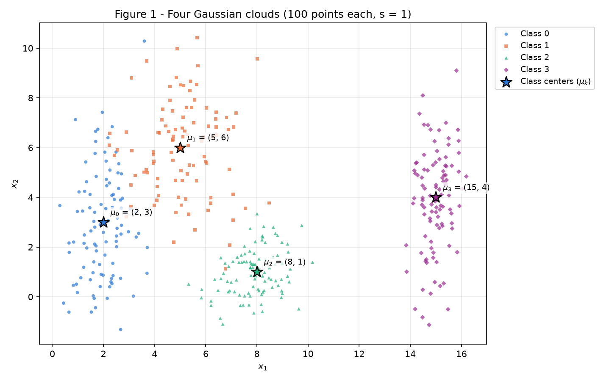
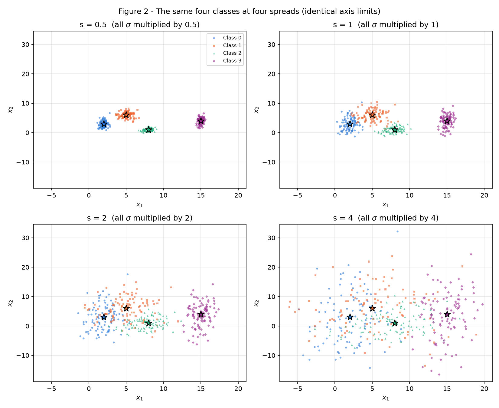
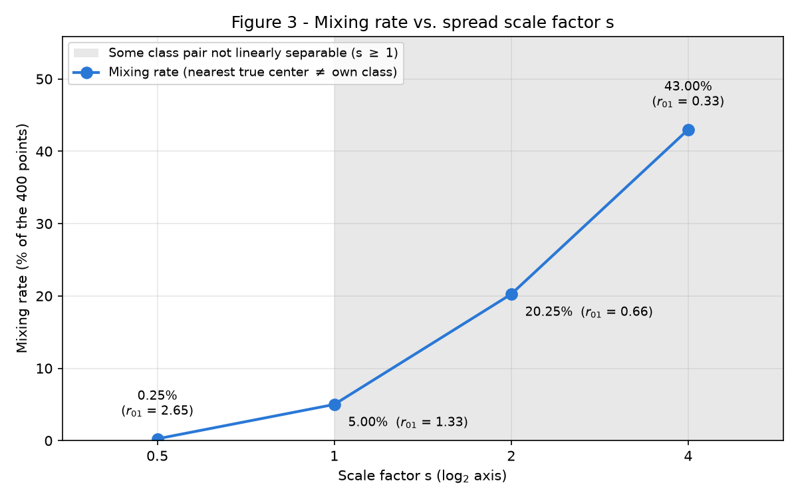
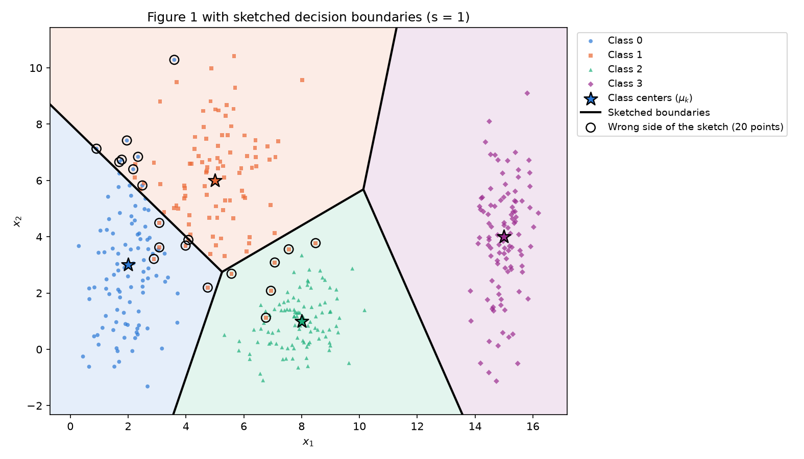
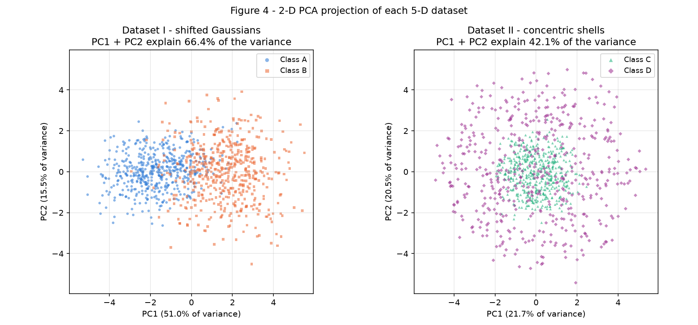
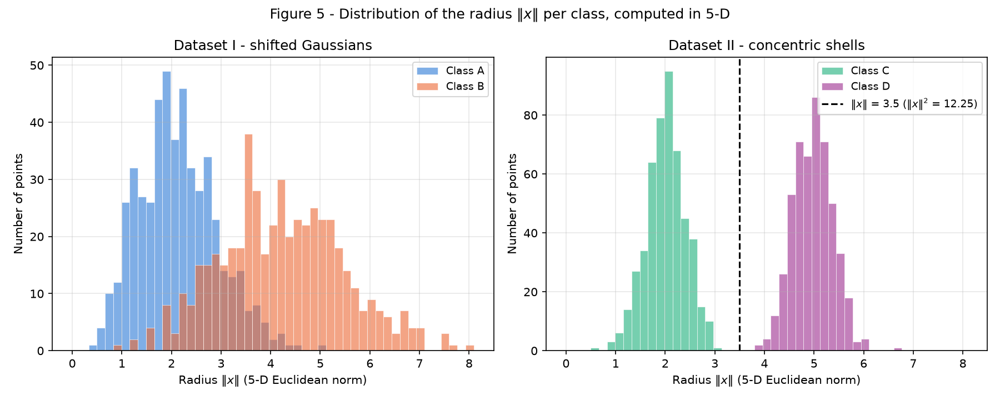
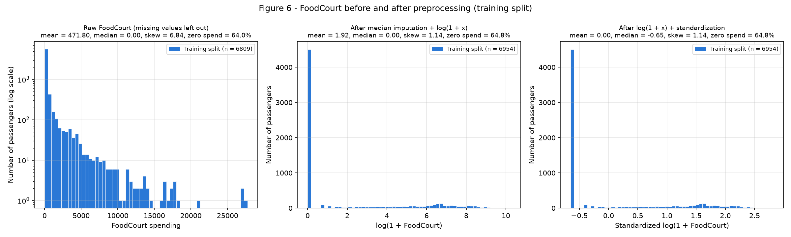

# 1. Data

This report generates and measures synthetic point clouds (Exercises 1 and 2) and prepares a real
Kaggle dataset for a `tanh` network (Exercise 3). The thread is the **spread** of the data: how far a
cloud extends, in which direction, and what that does to the boundaries a network would need.
Statement: [Exercises → 1. Data (2026.2)](https://insper.github.io/ann-dl/2026.2/exercises/data/){:target='_blank'}.

**How to re-run.** From the repository root:

```bash
python docs/exercises/data/code/main.py
```

The script regenerates every figure in `figures/` and prints every number quoted below, one labelled
line per number. Exercise 3 needs Kaggle's `train.csv` (see [Getting the data](#exercise-3)); without
it the script still runs Exercises 1 and 2 and prints the download instructions.

**Seed policy.** `main.py` creates the report's only generator, `rng = np.random.default_rng(42)`, and
passes it to `ex1(rng)`, `ex2(rng)` and `ex3(rng)` in statement order. No module creates a generator
of its own, so the whole report is one reproducible random stream: running the script twice gives
byte-identical figures and identical numbers. No model is trained anywhere; scikit-learn is used
only for PCA (Exercise 2) and for preprocessing (Exercise 3).

``` { .python .copy linenums='1' title="main.py" }
--8<-- "docs/exercises/data/code/main.py"
```

## Exercise 1

**Point clouds: geometry and spread in 2D.** The only random draw in this exercise is one array of
standard-normal noise $z$ of shape $(4, 100, 2)$ from the report's `rng`, turned into points by
$x = \mu_k + s\,\sigma_k \odot z$ (independent per-axis Gaussians). Item A uses $s = 1$; item B
**reuses the same noise** for every $s \in \{0.5, 1, 2, 4\}$, so the four datasets differ only in
spread and the $s = 1$ dataset of item B is exactly the dataset of Figure 1. Separation ratios use the
specified parameters, the mixing rate is plain NumPy geometry against the four true means, and an
exact convex-hull test decides whether a pair of classes can be split by one straight line.

??? example "Driver of Exercise 1 (`ex1`): runs A → B → C and prints every number"

    ``` { .python .copy linenums='1' title="ex1_point_clouds.py" }
    --8<-- "docs/exercises/data/code/ex1_point_clouds.py:ex1"
    ```

### A — Generate the clouds

The four classes use the statement's parameters, 100 points each (400 in total):

| Class | Mean $\mu_k$ | Standard deviation $\sigma_k$ | Sample mean | Sample std |
| --- | --- | --- | --- | --- |
| 0 | $[2, 3]$ | $[0.8, 2.5]$ | $(1.99, 2.88)$ | $(0.73, 2.14)$ |
| 1 | $[5, 6]$ | $[1.2, 1.9]$ | $(5.07, 5.96)$ | $(1.28, 1.86)$ |
| 2 | $[8, 1]$ | $[0.9, 0.9]$ | $(7.90, 0.98)$ | $(0.91, 0.92)$ |
| 3 | $[15, 4]$ | $[0.5, 2.0]$ | $(14.99, 3.88)$ | $(0.52, 2.02)$ |

The sample statistics match the specification up to the sampling noise of 100 points per class; the
largest deviation is class 0's $\sigma_y$ (2.14 measured vs. 2.5 specified).

``` { .python .copy linenums='1' title="ex1_point_clouds.py" }
--8<-- "docs/exercises/data/code/ex1_point_clouds.py:params"
```

``` { .python .copy linenums='1' title="ex1_point_clouds.py" }
--8<-- "docs/exercises/data/code/ex1_point_clouds.py:generate"
```

``` { .python .copy linenums='1' title="ex1_point_clouds.py" }
--8<-- "docs/exercises/data/code/ex1_point_clouds.py:fig1"
```


/// caption
**Figure 1** — The 400 points, one color and marker per class; the stars mark each cloud's center $\mu_k$.
///

### B — More or less spread out

**How the four datasets are drawn.** The noise $z$ from item A is drawn once and rescaled:
point $i$ of class $k$ sits at $\mu_k + s\,\sigma_k \odot z_i$ for every $s$. The means never move, all
standard deviations are multiplied by $s$, and because the noise is shared, any change between the
datasets is caused by the spread alone, not by a new random draw. This gives 4 datasets of 4 classes
(100 points per class each).

**1. Figure 2.** The four subplots share the same axis limits, $x_1 \in [-7.38, 21.06]$ and
$x_2 \in [-18.95, 34.57]$: the bounding box of all four datasets plus a 5% margin. At $s = 0.5$ the
clouds are compact islands; at $s = 4$ they cover the whole window.

``` { .python .copy linenums='1' title="ex1_point_clouds.py" }
--8<-- "docs/exercises/data/code/ex1_point_clouds.py:fig2"
```


/// caption
**Figure 2** — The same four classes at $s = 0.5, 1, 2, 4$ with identical axis limits; the stars are the (unchanged) means.
///

**2. Separation ratio at $s = 1$.** With $\bar\sigma_k = (\sigma_{k,x} + \sigma_{k,y})/2$ computed from
the specified parameters ($\bar\sigma_0 = 1.65$, $\bar\sigma_1 = 1.55$, $\bar\sigma_2 = 0.90$,
$\bar\sigma_3 = 1.25$):

$$
r_{ij} = \frac{\lVert \mu_i - \mu_j \rVert}{\bar\sigma_i + \bar\sigma_j}
$$

| Pair $(i, j)$ | $\lVert \mu_i - \mu_j \rVert$ | $\bar\sigma_i + \bar\sigma_j$ | $r_{ij}$ at $s = 1$ |
| --- | --- | --- | --- |
| (0, 1) | 4.2426 | 3.20 | **1.3258** (smallest) |
| (0, 2) | 6.3246 | 2.55 | 2.4802 |
| (0, 3) | 13.0384 | 2.90 | 4.4960 |
| (1, 2) | 5.8310 | 2.45 | 2.3800 |
| (1, 3) | 10.1980 | 2.80 | 3.6422 |
| (2, 3) | 7.6158 | 2.15 | 3.5422 |

The smallest ratio is **$r_{01} = 1.326$, between classes 0 and 1**: their centers are only 1.33
"average spreads" apart. Every $\bar\sigma_k$ is multiplied by $s$ while the means stay put, so
$r_{ij}(s) = r_{ij}(1)/s$. At $s = 2$, without generating anything, $r_{01} = 1.3258 / 2 = 0.663$.

``` { .python .copy linenums='1' title="ex1_point_clouds.py" }
--8<-- "docs/exercises/data/code/ex1_point_clouds.py:ratio"
```

**3. Mixing rate.** For each point we find the nearest of the four **true** means and count the
points whose nearest mean is not their own class's:

$$
\text{mixing}(s) = \frac{1}{400} \sum_{n=1}^{400} \mathbb{1}\!\left[\arg\min_k \lVert x_n - \mu_k \rVert \neq y_n\right]
$$

| $s$ | Mixing rate | Mixed points | Where they go (true class → nearest center) |
| --- | --- | --- | --- |
| 0.5 | **0.25%** | 1 of 400 | 0→1: 1 |
| 1.0 | **5.00%** | 20 of 400 | 0→1: 8, 1→0: 6, 1→2: 6 |
| 2.0 | **20.25%** | 81 of 400 | 0↔1: 48, 1↔2: 18, 0↔2: 7, 2↔3: 7, 1→3: 1 |
| 4.0 | **43.00%** | 172 of 400 | every pair except 0↔3; 0↔1: 57, 1↔2: 36, 0↔2: 34, 2↔3: 33, 1↔3: 12 |

``` { .python .copy linenums='1' title="ex1_point_clouds.py" }
--8<-- "docs/exercises/data/code/ex1_point_clouds.py:mixing"
```

**4. Figure 3 and the separability threshold.** The mixing rate counts errors of one particular set
of straight lines: the nearest-center boundaries. To answer "from which $s$ on can the clouds no longer
be separated by straight lines?" exactly, the code also tests every pair of classes: two finite point
sets can be split by a single straight line if and only if their convex hulls do not intersect. The
test is pure geometry on the sampled points; nothing is fitted. If every pair is separable, a set of
straight lines (one per pair, with one-vs-one voting) classifies all 400 points correctly.

| $s$ | Pairs that **no** straight line separates | Smallest ratio $r_{01}$ |
| --- | --- | --- |
| 0.5 | none | 2.65 |
| 1.0 | (0, 1), (1, 2) | 1.33 |
| 2.0 | (0, 1), (0, 2), (1, 2) | 0.66 |
| 4.0 | (0, 1), (0, 2), (1, 2), (1, 3), (2, 3) | 0.33 |

**From $s = 1$ on, the clouds can no longer be separated by straight lines.** At $s = 0.5$ the
nearest-center lines still misplace one point (0.25%), but the hull test shows a slightly moved line
would fix it: all 6 pairs are linearly separable. At $s = 1$ the convex hulls of classes 0 and 1 (and
of 1 and 2) intersect, so any straight boundary between them misclassifies at least one point, and the
mixing rate is 5.00%. **At that point the smallest ratio is $r_{01} = 1.33$** (it was 2.65 at
$s = 0.5$). The distance between the centers of classes 0 and 1 (4.24) is then only 1.33 times the sum
of their average spreads (3.20), so the two clouds meet roughly 1.3 average spreads from each center,
and with 100 points per class a handful of points of each class reach past that meeting zone: the 14
points 0↔1 of the mixing table. $r_{01}$ crosses 1 at $s = 1.33$; at $s = 2$ it is 0.66, the distance
between the centers is smaller than the sum of the spreads, and the mixing rate jumps to 20.25%.

Gaussian tails never end, so in theory any two of these clouds overlap at every $s$, and a large
enough sample is never linearly separable. The threshold $s = 1$ describes **these 100-point samples**.
With more points per class the extreme tails would reach further and separability would be lost at a
smaller $s$.

$r_{ij}$ is a summary, not an exact criterion, because it averages the two axis spreads and ignores
their direction. Pair (1, 2) already fails at $s = 1$ although $r_{12} = 2.38$, while pair (0, 2), with
almost the same $r_{02} = 2.48$, is still separable at $s = 1$ and fails only at $s = 2$. Measuring
each cloud's spread **along the line joining the two centers** (unit vector $d$),
$\sigma_{k,\text{dir}} = \sqrt{d_x^2\sigma_{k,x}^2 + d_y^2\sigma_{k,y}^2}$, explains the difference. That ratio is 2.21 for (1, 2), because class 1 is widest along $y$, the
direction of $\mu_2 - \mu_1$. It is 3.17 for (0, 2), because class 0's large $\sigma_y = 2.5$ is almost
perpendicular to $\mu_2 - \mu_0$. For (0, 1) it is 1.23.

``` { .python .copy linenums='1' title="ex1_point_clouds.py" }
--8<-- "docs/exercises/data/code/ex1_point_clouds.py:separable"
```

``` { .python .copy linenums='1' title="ex1_point_clouds.py" }
--8<-- "docs/exercises/data/code/ex1_point_clouds.py:fig3"
```


/// caption
**Figure 3** — Mixing rate vs. $s$ (log₂ axis), labelled with the smallest ratio $r_{01}$; the gray band marks the scales where some pair of classes is no longer linearly separable.
///

### C — Analysis

**1. Overlap at $s = 1$; one or several linear boundaries?** Figure 1 shows three situations.
Class 3 is isolated: no point of any class is assigned to it or leaves it (all its ratios are
$\geq 3.54$). Classes 1 and 2 only touch: 6 class-1 points are nearer to $\mu_2$. Classes 0 and 1
interpenetrate: the tall class-0 cloud ($\sigma_y = 2.5$) reaches into class 1, with 8 + 6 = 14 points
on the wrong side of their bisector. In total 20 of 400 points (5.00%) are closer to another center.

- A **single** linear boundary cannot separate the four classes: one line divides the plane into only
  two half-planes, so at least two classes always share a side.
- A **set** of linear boundaries does most of the job. The five bisector segments of the sketch below
  classify 380 of 400 points (95%), and class 3 alone needs just one line through the empty band
  visible in Figure 1. They cannot reach 100%:
  pairs (0, 1) and (1, 2) are not linearly separable (hull test), so no arrangement of straight lines
  with one convex region per class avoids errors there. Only a wiggly, non-convex boundary could, and
  that would be fitting the noise.

**2. Sketch on Figure 1.** The boundaries I expect a trained network to learn are the perpendicular
bisectors between neighbouring centers. They are drawn as black segments over a copy of Figure 1, with
each region tinted by its class. The segments are 0|1, 0|2, 1|2, 1|3 and 2|3 (classes 0 and 3 never
meet). Concretely:

- two steep segments (1|3 and 2|3) run through the empty band between the class-2 and class-3
  clouds and isolate class 3;
- the diagonal line $x_1 + x_2 = 8$ (the bisector of $\mu_0 = (2,3)$ and $\mu_1 = (5,6)$) cuts through
  the 0/1 overlap;
- two shorter segments (0|2 and 1|2) meet at the point equidistant from $\mu_0$, $\mu_1$ and
  $\mu_2$ and close off class 2 from classes 0 and 1.

A network with a few hidden units would produce a smoothed, slightly bent version of these segments,
because unequal spreads shift the best boundary toward the narrower cloud. Where the clouds overlap it
cannot do much better than the sketch: the circled points (20, all in the 0|1 and 1|2 overlap zones)
sit on the wrong side.

``` { .python .copy linenums='1' title="ex1_point_clouds.py" }
--8<-- "docs/exercises/data/code/ex1_point_clouds.py:sketch"
```


/// caption
**Figure 1 with sketched boundaries** — Perpendicular-bisector boundaries between neighbouring centers; circled points (20) fall on the wrong side.
///

**3. Relation to item B.** First, the threshold from item B: **linear separability is lost from
$s = 1$**, where the smallest separation ratio is $r_{01} = 1.33$. At $s = 0.5$ ($r_{01} = 2.65$)
every pair can still be split by a line. $r_{01}$ drops below 1 at $s \approx 1.33$, and at $s = 2$
($r_{01} = 0.66$) three pairs are inseparable.

The region where a network necessarily makes mistakes is where the clouds overlap: points of different classes share the same coordinates, so no boundary can be right for both.
As the spread grows, that region widens and fills with more points. The share of points on the wrong
side of the sketched boundaries goes from 0.25% ($s = 0.5$) to 5.00% ($s = 1$), 20.25% ($s = 2$) and
43.00% ($s = 4$). The number of class pairs that no line can separate goes 0 → 2 → 3 → 5 out of 6.
The sketched boundaries do not move at all, since they depend only on the means, which are fixed. What
changes is how much probability mass lies beyond them, and that grows as $r_{ij}(s) = r_{ij}(1)/s$
shrinks. A better-trained network can bend its boundaries to trade some of these errors between
classes, but it cannot remove them: at $s = 4$, 43% of the points are closer to another class's center
than to their own, and five of the six pairs overlap.

## Exercise 2

**Non-linearity in higher dimensions.** Dataset I (two shifted 5-D Gaussians) is drawn with
`rng.multivariate_normal` after checking that both covariance matrices are positive definite, and
Dataset II (concentric shells) multiplies a direction $v/\lVert v\rVert$, $v \sim \mathcal N(0, I_5)$,
by a Gaussian radius. Both are projected with a 2-component PCA (labels unused, data centered, not
scaled since all features share units), while center distances and radii are measured in the original
5-D space. The final separating function uses a threshold derived from the **specified** radii, so
nothing is fitted.

??? example "Driver of Exercise 2 (`ex2`): runs A → D and prints every number"

    ``` { .python .copy linenums='1' title="ex2_nonlinearity.py" }
    --8<-- "docs/exercises/data/code/ex2_nonlinearity.py:ex2"
    ```

### A — Dataset I: shifted Gaussians

500 samples per class, with

$$
\mu_A = \vec 0,\quad
\Sigma_A = \begin{pmatrix}
1.0 & 0.8 & 0.1 & 0.0 & 0.0\\
0.8 & 1.0 & 0.3 & 0.0 & 0.0\\
0.1 & 0.3 & 1.0 & 0.5 & 0.0\\
0.0 & 0.0 & 0.5 & 1.0 & 0.2\\
0.0 & 0.0 & 0.0 & 0.2 & 1.0
\end{pmatrix},\qquad
\mu_B = [1.5]^5,\quad
\Sigma_B = \begin{pmatrix}
1.5 & -0.7 & 0.2 & 0.0 & 0.0\\
-0.7 & 1.5 & 0.4 & 0.0 & 0.0\\
0.2 & 0.4 & 1.5 & 0.6 & 0.0\\
0.0 & 0.0 & 0.6 & 1.5 & 0.3\\
0.0 & 0.0 & 0.0 & 0.3 & 1.5
\end{pmatrix}
$$

**Positive-definiteness check (before sampling).** Both matrices are symmetric with strictly positive
eigenvalues, so they are valid covariances:

- $\Sigma_A$: eigenvalues $\{0.1582, 0.4677, 0.9899, 1.4576, 1.9266\}$, minimum 0.1582;
- $\Sigma_B$: eigenvalues $\{0.4979, 1.0247, 1.5418, 2.1239, 2.3117\}$, minimum 0.4979.

**Sanity check of the samples.** The sample means are $[0.054, 0.078, 0.001, 0.006, 0.006]$ (A) and
$[1.541, 1.490, 1.534, 1.555, 1.525]$ (B). The sample correlation between $x_1$ and $x_2$ is $+0.801$ in
A (specified $0.8$) and $-0.530$ in B (specified $-0.7/1.5 = -0.467$). This is the opposite tilt the
statement points out: class B is more spread out and correlated the other way.

``` { .python .copy linenums='1' title="ex2_nonlinearity.py" }
--8<-- "docs/exercises/data/code/ex2_nonlinearity.py:params_I"
```

``` { .python .copy linenums='1' title="ex2_nonlinearity.py" }
--8<-- "docs/exercises/data/code/ex2_nonlinearity.py:pd_check"
```

``` { .python .copy linenums='1' title="ex2_nonlinearity.py" }
--8<-- "docs/exercises/data/code/ex2_nonlinearity.py:dataset_I"
```

### B — Dataset II: concentric shells

For each class, 500 directions $v \sim \mathcal N(0, I_5)$ are normalized to $u = v/\lVert v\rVert$.
The standard normal is rotation-invariant, so $u$ is uniform on the unit sphere of $\mathbb R^5$. Each
direction is multiplied by its own radius: $\rho \sim \mathcal N(2.0, 0.4)$ for class C (core) and
$\rho \sim \mathcal N(5.0, 0.4)$ for class D (shell), with 0.4 the standard deviation, giving
$x = \rho\,u$.

- All 1000 directions have $\lVert u\rVert = 1.000000$ (min and max), so the normalization is correct.
- Measured radii: class C mean 2.010, std 0.396, range $[0.588, 2.990]$; class D mean 4.979, std
  0.398, range $[3.850, 6.660]$. No radius came out negative, which would require a $5\sigma$ draw.

``` { .python .copy linenums='1' title="ex2_nonlinearity.py" }
--8<-- "docs/exercises/data/code/ex2_nonlinearity.py:params_II"
```

``` { .python .copy linenums='1' title="ex2_nonlinearity.py" }
--8<-- "docs/exercises/data/code/ex2_nonlinearity.py:dataset_II"
```

### C — Visualize and compare

**1. Figure 4.** PCA is fitted separately on each dataset's 1000 points and the two projections are
plotted side by side with the same axis limits.

``` { .python .copy linenums='1' title="ex2_nonlinearity.py" }
--8<-- "docs/exercises/data/code/ex2_nonlinearity.py:pca"
```


/// caption
**Figure 4** — 2-D PCA projection of Dataset I (left, classes A/B) and Dataset II (right, classes C/D), same axis limits.
///

**2. Explained variance of the first two components.**

| Dataset | PC1 | PC2 | **PC1 + PC2** |
| --- | --- | --- | --- |
| I — shifted Gaussians | 50.96% | 15.47% | **66.44%** |
| II — concentric shells | 21.66% | 20.49% | **42.15%** |

**The 2-D projection of Dataset I preserves the information relevant for classification much better.**
In Dataset I the shift between the class means, $\mu_B - \mu_A = [1.5]^5$, adds a large share of
variance along one direction, and PCA picks it up: PC1 is almost parallel to the difference between the
sample class means ($|\cos| = 0.9923$). The left panel of Figure 4 therefore shows A and B side by side
along PC1, with an overlap band in the middle.

In Dataset II no direction is special. Both classes are rotation-invariant, so PC1 + PC2 = 42.15%,
close to the 40% expected for an isotropic cloud in 5-D, and the class information, the radius, is
spread over all five coordinates. Dropping three of them
shrinks the radius of every point by a random amount: **61.00% of the shell points land inside the
2-D disk of radius 3.5**, on top of the core (right panel). The explained variance alone does not
measure class information, but here both point the same way.

**3. Geometric measures in 5-D.**

- **Distance between class centers**, $\lVert\hat\mu_1 - \hat\mu_2\rVert$ with sample means:
  **Dataset I: 3.3559** (specified $\lVert[1.5]^5\rVert = \sqrt{11.25} = 3.3541$).
  **Dataset II: 0.2614** (specified 0; the residual is sampling noise of the two means).
- **Figure 5, radius $\lVert x\rVert$ of each point.** In Dataset I the radii overlap: A has mean 2.130
  and range $[0.456, 4.975]$, B has mean 4.223 and range $[0.951, 7.934]$. In Dataset II they are
  disjoint: the core's largest radius is 2.990 and the shell's smallest is 3.850, which leaves an empty
  gap around the dashed line $\lVert x\rVert = 3.5$.

``` { .python .copy linenums='1' title="ex2_nonlinearity.py" }
--8<-- "docs/exercises/data/code/ex2_nonlinearity.py:geometry"
```


/// caption
**Figure 5** — Histogram of the 5-D radius $\lVert x\rVert$ per class, both classes overlaid: Dataset I (left) overlaps, Dataset II (right) is split by $\lVert x\rVert = 3.5$.
///

### D — Analysis

**1. Coincident centers, separated radii: what about a hyperplane?** A hyperplane classifier
$\operatorname{sign}(w^\top x + b)$ only looks at the projection $w^\top x$. In Dataset II both classes
are centered at the same point (distance 0.2614) and are rotation-invariant. Along **any** direction
$w$, the core (radius $\approx 2$) projects into about $[-2, 2]$ and the shell (radius $\approx 5$)
into about $[-5, 5]$, both centered on 0, so the shell's projection covers the core's from both
sides. Shifting or tilting the hyperplane only trades errors on one side for errors on the other. The radius histograms, in contrast, are disjoint
(gap 2.990 → 3.850). The separating information is in the **norm**, a non-linear function of $x$, not
in any linear combination of the coordinates.

The best accuracy any hyperplane can reach is computable. One coordinate of a uniform direction on the
sphere of $\mathbb R^5$ has density $\tfrac34(1-a^2)$ on $[-1, 1]$. Scanning the offset $t$ of the rule
"shell if $w^\top x > t$" for ideal radii 2 and 5 gives at best **62.01%** ($t = 1.601$), against 50% for
guessing. Applying that rule to the sample with $w = e_1$ gives **61.50%**, while $\lVert x\rVert^2$ gets
100% (below). For contrast, on Dataset I the hyperplane that bisects the specified means $\mu_A$ and
$\mu_B$, a linear rule with nothing fitted, already classifies **89.60%** of the points.

``` { .python .copy linenums='1' title="ex2_nonlinearity.py" }
--8<-- "docs/exercises/data/code/ex2_nonlinearity.py:separator"
```

**2. Why no linear boundary works, however much data is collected.** Two finite sets are linearly
separable if and only if their convex hulls do not intersect. The shell surrounds the core in every
direction of $\mathbb R^5$, so every core point is a convex combination of shell points: the core lies
**inside** the convex hull of the shell, and no hyperplane can have all core points on one side and
all shell points on the other. Collecting more data does not help. More shell points cover the sphere
more densely, so the shell's hull approaches the full ball of radius $\approx 5$ and the core sits
inside it even more surely. The 62.01% ceiling above is a property of the distributions, not of the
sample size; more data only estimates it more precisely. This is a limit of the model family
(hyperplanes), not a lack of data.

**3. PCA is linear: does a mixed 2-D projection prove inseparability? No.** A projection can only
**lose** separability, never create it. PCA is unsupervised: it keeps the directions of largest
variance, not the directions that separate the classes, and it discards the rest. Points that differ
only in the discarded directions collapse onto each other. My results show this directly. In Figure 4
Dataset II looks mixed: 61.00% of the shell points fall inside the core's 2-D disk, and the two
components keep only 42.15% of the variance. Yet in the original 5-D space the classes are perfectly
separable by a simple function of the inputs:

$$
f(x) = \lVert x\rVert^2 - 12.25 = \sum_{i=1}^{5} x_i^2 - 12.25,\qquad
\hat y = \begin{cases} \text{D (shell)} & f(x) > 0 \\ \text{C (core)} & f(x) < 0 \end{cases}
$$

The threshold comes from the specified radii, not from the data: halfway between 2 and 5 is 3.5, and
$3.5^2 = 12.25$. **This rule classifies 1000 of 1000 points correctly (100%).** It also has a wide
margin: the largest $\lVert x\rVert^2$ in the core is 8.941 and the smallest in the shell is 14.823.
$f$ is quadratic in $x$ but **linear in the features $x_i^2$**. In the lifted space $z = (x_1^2, \dots,
x_5^2)$ it is a hyperplane. That non-linear change of representation is exactly what a hidden layer can
learn and a Perceptron cannot.

## Exercise 3

**Preparing real-world data for a neural network.** The Spaceship Titanic `train.csv` is loaded and
described first: target balance, feature types, missing values and spending statistics, all
descriptive numbers of the raw file that never feed a transformer. Then it is split 80/20, stratified
by `Transported`, with a seed drawn from the report's `rng`, **before** any statistic is fitted. A
single scikit-learn `ColumnTransformer` is fitted on the training split only and applied unchanged to
the test split:

- numerical columns: median imputation;
- spending columns: `TotalSpend`, then $\log(1+x)$;
- all numerical columns: standardization;
- categorical columns: most-frequent imputation, then one-hot encoding.

The checks at the end confirm that no `NaN` remains, report the shapes, and verify the value range.

!!! note "Getting the data"

    The CSV is not committed (Kaggle competition rules; the folder `code/raw/` is git-ignored).
    To reproduce Exercise 3:

    1. Open the competition page <https://www.kaggle.com/competitions/spaceship-titanic>, sign in,
       open the **Data** tab and accept the competition rules.
    2. Download `train.csv` (the only labelled file).
    3. Save it as `docs/exercises/data/code/raw/train.csv` and run `main.py` again.

??? example "Driver of Exercise 3 (`ex3`): runs A → D and prints every number"

    ``` { .python .copy linenums='1' title="ex3_spaceship.py" }
    --8<-- "docs/exercises/data/code/ex3_spaceship.py:ex3"
    ```

### A — Get to know the data

**1. Dataset.** Kaggle's [Spaceship Titanic](https://www.kaggle.com/competitions/spaceship-titanic)
`train.csv`, the only labelled file: **8693 rows × 14 columns**. It is read with `CryoSleep` and `VIP`
as text, so all four categorical columns behave alike. This is a stateless type fix; no statistic is
computed while loading.

``` { .python .copy linenums='1' title="ex3_spaceship.py" }
--8<-- "docs/exercises/data/code/ex3_spaceship.py:columns"
```

``` { .python .copy linenums='1' title="ex3_spaceship.py" }
--8<-- "docs/exercises/data/code/ex3_spaceship.py:load"
```

**2. Goal and class balance.** Each row is a passenger of the *Spaceship Titanic*, which collided with
a spacetime anomaly. `Transported` (True/False) records whether that passenger was transported to
another dimension. It is the target of a **binary classification** problem: predict it from the
passenger's records.

| `Transported` | Count | Share |
| --- | --- | --- |
| True | 4378 | **50.36%** |
| False | 4315 | 49.64% |

The classes are essentially balanced (4378 vs. 4315 rows). Accuracy is therefore
a meaningful metric, a constant guess cannot beat about 50%, and no class re-weighting is needed.
Stratification still matters, because it keeps that balance identical in both splits (item B).

**3. Features by type.**

| Type | Columns | Treatment |
| --- | --- | --- |
| Numerical | `Age`, `RoomService`, `FoodCourt`, `ShoppingMall`, `Spa`, `VRDeck` | median imputation, (spending: $\log(1+x)$), standardization |
| Numerical (engineered) | `TotalSpend` = sum of the five spending columns | $\log(1+x)$, standardization |
| Categorical | `HomePlanet`, `CryoSleep` (bool), `Destination`, `VIP` (bool) | most-frequent imputation, one-hot |
| Identifiers / free text | `PassengerId`, `Cabin`, `Name` | dropped, as the statement requires |
| Target | `Transported` (bool) | label, $1 = $ True, $0 = $ False |

**4. Missing values per column** (full `train.csv`, 8693 rows; descriptive only, these counts never
feed a transformer):

| Column | Missing (count) | Missing (%) |
| --- | --- | --- |
| `CryoSleep` | 217 | 2.50 |
| `ShoppingMall` | 208 | 2.39 |
| `VIP` | 203 | 2.34 |
| `HomePlanet` | 201 | 2.31 |
| `Name` | 200 | 2.30 |
| `Cabin` | 199 | 2.29 |
| `VRDeck` | 188 | 2.16 |
| `Spa` | 183 | 2.11 |
| `FoodCourt` | 183 | 2.11 |
| `Destination` | 182 | 2.09 |
| `RoomService` | 181 | 2.08 |
| `Age` | 179 | 2.06 |
| `PassengerId` | 0 | 0.00 |
| `Transported` | 0 | 0.00 |

Twelve of the 14 columns have gaps, and they are remarkably uniform: between 2.06% (`Age`) and 2.50%
(`CryoSleep`) each. Only the identifier `PassengerId` and the target are complete. No column is
missing so much that it should be dropped, so every gap is imputed (item C.1).

**5. Spending columns: mean, median, maximum** (full `train.csv`, before the split). These describe
the dataset as delivered and, like the counts above, are descriptive only: every statistic that a
transformer uses is fitted on the training split in item C. Results-summary row 11 asks for something
different, `FoodCourt` on the **training split** before transforming: mean **471.80**, median
**0.00** (printed after the split).

| Column (full file) | Mean | Median | Max | Skewness |
| --- | --- | --- | --- | --- |
| `RoomService` | 224.69 | 0.00 | 14327 | 6.33 |
| `FoodCourt` | 458.08 | 0.00 | 29813 | 7.10 |
| `ShoppingMall` | 173.73 | 0.00 | 23492 | 12.63 |
| `Spa` | 311.14 | 0.00 | 22408 | 7.64 |
| `VRDeck` | 304.85 | 0.00 | 24133 | 7.82 |

**Mean × median reading.** In all five columns the **median is 0**, while the means range from 173.73
to 458.08 and the maxima from 14327 to 29813. A median of 0 means at least half of the passengers spent
nothing on that amenity. A mean in the hundreds therefore comes entirely from a minority, and a few
passengers spent tens of times the mean or more. The distributions are extremely **right-skewed and
heavy-tailed**, with skewness between 6.33 and 12.63 (a symmetric distribution has 0). Their spread is
enormous compared with their center: the values run from 0 to tens of thousands with no typical
non-zero level. `Age` is the contrast: mean 28.83, median 27.00, range 0–79 and skewness 0.42, only a
mild right skew. On the raw spending scale a few passengers would sit far out in the tail, which
motivates the $\log(1+x)$ of item C.4.

``` { .python .copy linenums='1' title="ex3_spaceship.py" }
--8<-- "docs/exercises/data/code/ex3_spaceship.py:describe"
```

### B — Split before you transform

**1. Stratified 80/20 split, fixed seed.** `train_test_split(test_size=0.2, stratify=y,
random_state=seed)`. scikit-learn 1.9.1 does not accept a NumPy `Generator` as `random_state`; it
raises `InvalidParameterError` and accepts only an int or a legacy `RandomState`. So the code draws an
integer seed from the report's single `rng` right after Exercise 2, which keeps "the same `rng`
throughout" and still gives a fixed number: **seed = 579414713** on every run.

- Result: **6954 training rows and 1739 test rows**.
- The share of `Transported = True` is 50.36% in train and 50.37% in test, the same as the full file
  (50.36%), so the stratification worked.

``` { .python .copy linenums='1' title="ex3_spaceship.py" }
--8<-- "docs/exercises/data/code/ex3_spaceship.py:split"
```

**2. Why the split comes before imputation and scaling.** The test set stands in for future passengers
the network has never seen, so any statistic computed with it (an imputation median, a scaling mean or
standard deviation, the list of categories) would carry information about those rows into training.
Splitting first and fitting every transformer on the training part only transforms the test rows
exactly as new data would be. Otherwise the test score is optimistically biased (data leakage) and
stops being a trustworthy estimate of generalization.

### C — Preprocess

The whole preprocessing is one `ColumnTransformer` with three per-type pipelines. `preprocess()`
calls `fit` on the training split only, then `transform` on train and test. Every median, mode,
category list, mean and standard deviation is learned from train and reused unchanged on test.

``` { .python .copy linenums='1' title="ex3_spaceship.py" }
--8<-- "docs/exercises/data/code/ex3_spaceship.py:pipeline"
```

``` { .python .copy linenums='1' title="ex3_spaceship.py" }
--8<-- "docs/exercises/data/code/ex3_spaceship.py:fit"
```

**1. Missing data, one strategy per column type** (all imputers fitted on train, applied to test).
Every column misses only 2.06–2.50% of its values (A.4), so a single, simple imputation per type adds
little bias. A model-based imputer would add complexity for about 2% of the cells.

- **Numerical → median** (`SimpleImputer(strategy="median")`).
    - For the five spending columns the learned training medians are **all 0.0**, so a missing spend
      becomes "spent nothing", by far the most common value: 64.0% of the observed `FoodCourt` values
      in train are 0 (Figure 6).
    - The mean would be the wrong choice here. It is dragged up by the tail (471.80 for `FoodCourt` on
      train, with skewness 6.84), so it would invent a 471.80-credit `FoodCourt` bill for passengers who
      most likely spent nothing.
    - For `Age` the learned median is **27.00**. `Age` is only mildly skewed (mean 28.83 vs. median
      27.00, skewness 0.42), so mean and median are close. The median is kept for robustness and
      consistency, and it is a real, typical age.
- **Categorical → most frequent** (`SimpleImputer(strategy="most_frequent")`).
    - The learned modes are `HomePlanet` = Earth, `CryoSleep` = False, `Destination` = TRAPPIST-1e and
      `VIP` = False.
    - The mode is the only "central value" a category has, and it keeps every one-hot block a valid
      indicator with exactly one active column.
    - A separate "missing" level would add four columns, one per feature, for about 2% of the rows
      each, so the mode is the cheaper choice at this missingness.
    - Imputation runs **before** encoding, so a `NaN` never reaches the encoder.

**2. Categorical → numbers: one-hot encoding.** `HomePlanet`, `CryoSleep`, `Destination` and `VIP` are
one-hot encoded with `OneHotEncoder(handle_unknown="ignore")`. The categories learned on train are
Earth/Europa/Mars, False/True, 55 Cancri e/PSO J318.5-22/TRAPPIST-1e and False/True, which gives
**10 one-hot columns**. Each category becomes a 0/1 column, so the network sees no artificial order
(Earth < Europa < Mars would be meaningless).

A category that appears only in the test set is **ignored**: its whole block of columns is set to
**0**, with no error and no new column. The row then simply carries no information for that feature,
and the matrix keeps the same shape as in training. The code demonstrates it by replacing a test row's
`HomePlanet` with the unseen value `"Pluto"`: it encodes as `HomePlanet_Earth = HomePlanet_Europa =
HomePlanet_Mars = 0`. In the actual split no test category is unseen; every value of the four columns
in the 1739 test rows also occurs in train.

``` { .python .copy linenums='1' title="ex3_spaceship.py" }
--8<-- "docs/exercises/data/code/ex3_spaceship.py:unknown"
```

**3. Feature engineering: `TotalSpend`.**

$$
\text{TotalSpend} = \text{RoomService} + \text{FoodCourt} + \text{ShoppingMall} + \text{Spa} + \text{VRDeck}
$$

It is computed inside the spending pipeline **after** median imputation, so one missing column no
longer turns the sum into `NaN`. It is a row-wise sum with nothing to fit, and it summarizes the overall
spending level in one feature. `PassengerId`, `Cabin` and `Name` are dropped explicitly by
`drop_identifiers()` before fitting. They are identifiers or near-unique strings that a network could
only memorize.

**4. Heavy tails: $\log(1+x)$.** The five spending columns **and `TotalSpend`** go through
`np.log1p`. $\log(1+x)$ maps 0 to 0, stays defined for zero spending (where $\log x$ would be
$-\infty$), and compresses large values multiplicatively: 100 becomes 4.6, 10 000 becomes 9.2. The
before/after histogram is **Figure 6** (item D.1). For `FoodCourt` on the training split, the
skewness drops from **6.84** (raw) to **1.14** (after $\log(1+x)$), and the maximum shrinks from
27723 credits to 10.23.

**Why it helps a network with `tanh`.** $\tanh(z)$ is only sensitive for $|z|$ up to about 2–3.
Beyond that it saturates at ±1 and its derivative $1 - \tanh^2(z)$ is almost 0, so the weights feeding
that unit stop learning. The code measures what standardizing the raw columns would do: the largest
standardized value on the training split would be:

| Column | Largest standardized value, raw | Largest standardized value, after $\log(1+x)$ |
| --- | --- | --- |
| `RoomService` | 22.03 | 2.89 |
| `FoodCourt` | 16.80 | 2.82 |
| `ShoppingMall` | 37.81 | 3.32 |
| `Spa` | 19.98 | 2.96 |
| `VRDeck` | 20.61 | 3.06 |

Without the log, a single passenger 37.81 standard deviations from the mean would push any unit with
a non-trivial weight on `ShoppingMall` deep into saturation. Such values would also dominate the
weighted sums and the gradients. After $\log(1+x)$ every spending feature stays within about 3.3
standard deviations, the range where `tanh` still responds.

``` { .python .copy linenums='1' title="ex3_spaceship.py" }
--8<-- "docs/exercises/data/code/ex3_spaceship.py:tails"
```

**5. Scaling: standardization** (`StandardScaler`, $z = (x - \text{mean}_\text{train})/\text{std}_\text{train}$)
on the 7 numerical columns: `Age`, the five log-spends and log-`TotalSpend`. The 0/1 one-hot columns
are already on a `tanh`-compatible scale and are left as they are. Why standardization rather than
min-max to $[-1, 1]$:

- It centers every input at 0, where `tanh` is steepest ($\tanh'(0) = 1$).
- It gives unit variance, the assumption behind the usual Xavier/Glorot initialization, so the first
  pre-activations start around order 1.
- Min-max lets the extremes define the whole range: the smallest and largest training values set the
  scale, so a single outlier squeezes everyone else into a narrow band, and test values outside the
  training range break the $[-1, 1]$ promise anyway.

The resulting range is not $[-1, 1]$, but the values are of order 1, which is what `tanh` needs.

| Split | Min (scaled numerical columns) | Max (scaled numerical columns) |
| --- | --- | --- |
| Train | **−2.0118** | **3.5156** |
| Test | **−2.0118** | **3.5156** |

- **Train and test have the same extremes** because both come from `Age`: the youngest (0 years) and
  oldest (79 years) passengers appear in both splits.
- On train the scaled columns have mean 0 and standard deviation 1 by construction (the code prints
  them).
- The log-spending columns stay inside $[-0.6632, 3.3172]$ on train and `TotalSpend` inside
  $[-1.1480, 1.6936]$.
- The test set is transformed with the training statistics, so it can step slightly outside the
  training range: the largest test `FoodCourt` is 2.8479, above the training maximum of 2.8232.
- Over the whole matrix, one-hot columns included, the range is the same $[-2.0118, 3.5156]$ in both
  splits.

### D — Verify and visualize

**1. Figure 6.** `FoodCourt` on the training split in three stages: raw (missing values left out),
after median imputation and $\log(1+x)$, and after standardization. Each panel title prints its mean,
median, skewness and share of zero spending, and `main.py` prints the same values. The figure also
serves as the "histogram before and after" asked for in C.4.

``` { .python .copy linenums='1' title="ex3_spaceship.py" }
--8<-- "docs/exercises/data/code/ex3_spaceship.py:fig6"
```


/// caption
**Figure 6** — `FoodCourt` on the training split: raw, with counts on a log scale (left); after median imputation and $\log(1+x)$ (middle); after standardization (right).
///

**Reading of Figure 6.**

- **Raw panel (6809 non-missing values, counts on a log scale).** 64.0% of the passengers spent
  nothing, so the first bar holds thousands of passengers. The counts then decay over several orders
  of magnitude, down to single passengers spending more than 20 000 credits. The mean (471.80) sits far
  above the median (0.00) because these few large spenders pull it up, and the x-axis must stretch to
  27723 to include them. The skewness is 6.84. On a linear count axis this tail would be an almost
  invisible sliver.
- **Log panel.** After imputation and $\log(1+x)$ the 6954 values fit between 0 and 10.23. The
  non-zero spenders now spread into a broad bump instead of an invisible tail, and the skewness falls
  to 1.14.
- **Standardized panel.** Standardization only shifts and rescales: the mean becomes 0.00, the zero
  spenders sit at −0.65 (the new median), and the shape and the skewness (1.14) are unchanged.
- **What no monotone transform removes.** The spike of zero spenders stays a separate bar, 64.8% of
  the training rows once the missing values are imputed as 0 (n grows from 6809 to 6954).

**2. Final checks, explicitly reported.**

- **No `NaN` remains:** 0 in the training matrix and 0 in the test matrix. The code asserts it, so the
  script would stop otherwise.
- **Final shape:** **(6954, 17)** for train and **(1739, 17)** for test. The 17 columns are 7
  numerical ones (`Age`, the five spending columns, `TotalSpend`) and 10 one-hot ones (`HomePlanet`
  3, `CryoSleep` 2, `Destination` 3, `VIP` 2).
- **Value range compatible with `tanh`:** the scaled numerical columns lie in $[-2.0118, 3.5156]$ in
  both splits, and the one-hot columns in $\{0, 1\}$. Every input is centered or binary, with
  magnitude at most 3.52, so with small initial weights the hidden pre-activations start in the zone
  where `tanh` is responsive, far from saturation.

``` { .python .copy linenums='1' title="ex3_spaceship.py" }
--8<-- "docs/exercises/data/code/ex3_spaceship.py:checks"
```

**3. Which decision would most affect training?** The $\log(1+x)$ on the spending columns, together
with scaling them. Six of the seven numerical inputs are spending features, and without the log their
largest standardized values would be 16.80 to 37.81 standard deviations from the mean, against 2.82 to
3.32 with it. Those few passengers would push `tanh` units into saturation, where the gradient
vanishes. They would also dominate the weighted sums and the loss gradient early in training, which
forces a small learning rate and slows learning for everyone else. The log turns a multiplicative
scale (tens vs. thousands of credits) into an additive one that a weighted sum can use.

What the log does not fix is the zero spike: 64.8% of the training `FoodCourt` values remain one
separate bar. The data hint at a better encoding. All 3037 passengers with `CryoSleep` = True have a
largest recorded spend of 0.0, since cryosleepers are confined to their cabins. A binary "spent
anything" flag, or a network that learns this `CryoSleep`–spending link, could exploit that structure.
By comparison, the imputation choices touch only 2.06–2.50% of each column, and one-hot encoding four
low-cardinality columns (10 columns in total) is standard and low-risk.

## Results summary

| # | Item | Your value |
| --- | --- | --- |
| 1 | Mixing rate at $s=0.5$ | 0.25% (1 of 400 points) |
| 2 | Mixing rate at $s=1.0$ | 5.00% (20 of 400 points) |
| 3 | Mixing rate at $s=2.0$ | 20.25% (81 of 400 points) |
| 4 | Mixing rate at $s=4.0$ | 43.00% (172 of 400 points) |
| 5 | Smallest $r_{ij}$ at $s=1.0$, and which pair | $r_{01} = 1.326$, classes 0 and 1 (becomes 0.663 at $s=2$) |
| 6 | Distance between centers — Dataset I | 3.356 (specified $\sqrt{11.25} = 3.354$) |
| 7 | Distance between centers — Dataset II | 0.261 (specified 0) |
| 8 | Explained variance PC1 + PC2 — Dataset I | 66.44% (50.96% + 15.47%) |
| 9 | Explained variance PC1 + PC2 — Dataset II | 42.15% (21.66% + 20.49%) |
| 10 | Share of the positive class in `Transported` | 50.36% (4378 of 8693 rows are True) |
| 11 | Mean and median of `FoodCourt` on the training set, before transforming | mean 471.80, median 0.00 |
| 12 | Final `shape` of the training feature matrix | (6954, 17) |
| 13 | Minimum and maximum of the training and test sets after scaling | train [−2.0118, 3.5156], test [−2.0118, 3.5156] (scaled numerical columns; one-hot columns in {0, 1}) |
