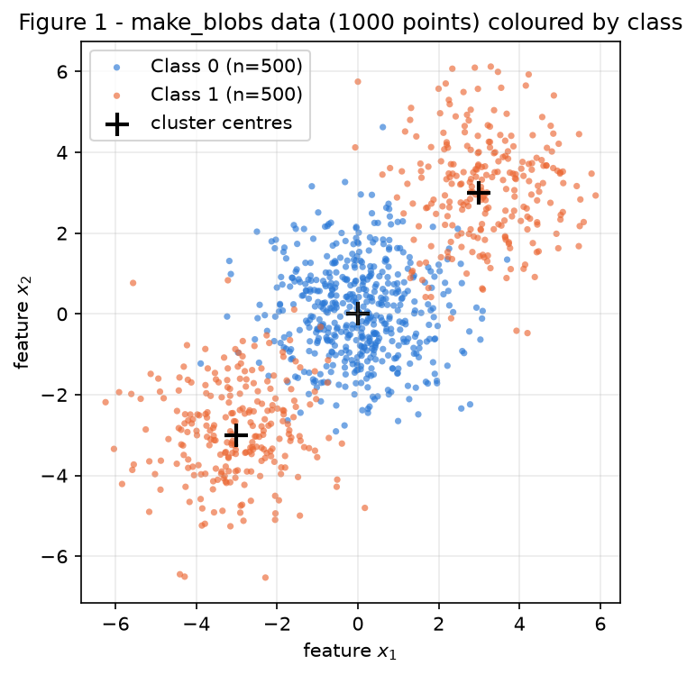
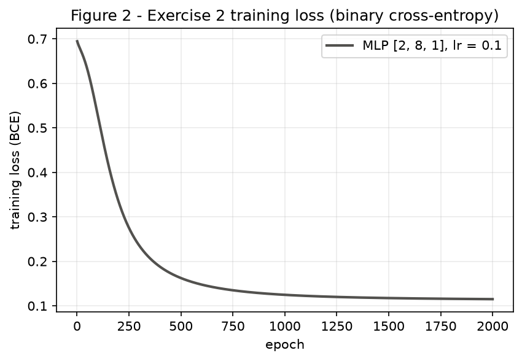
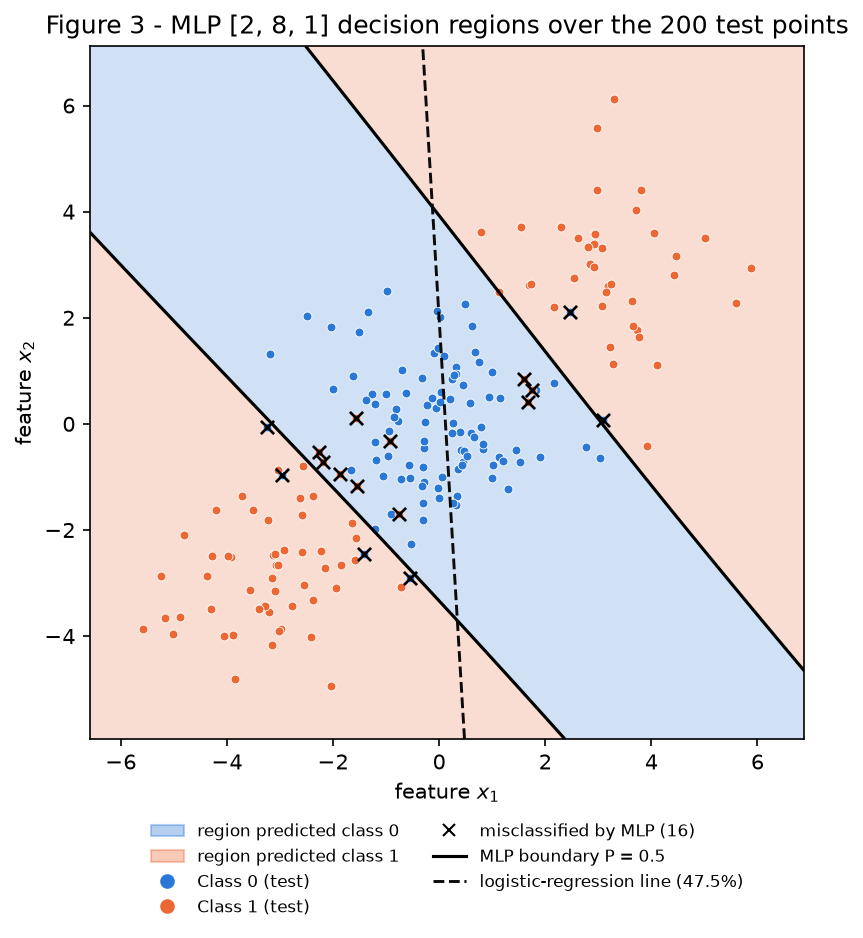
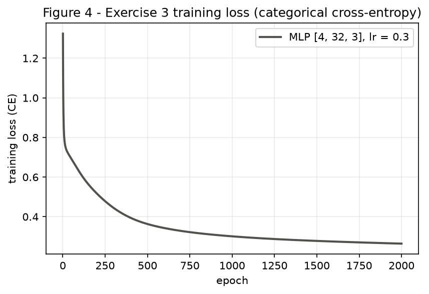
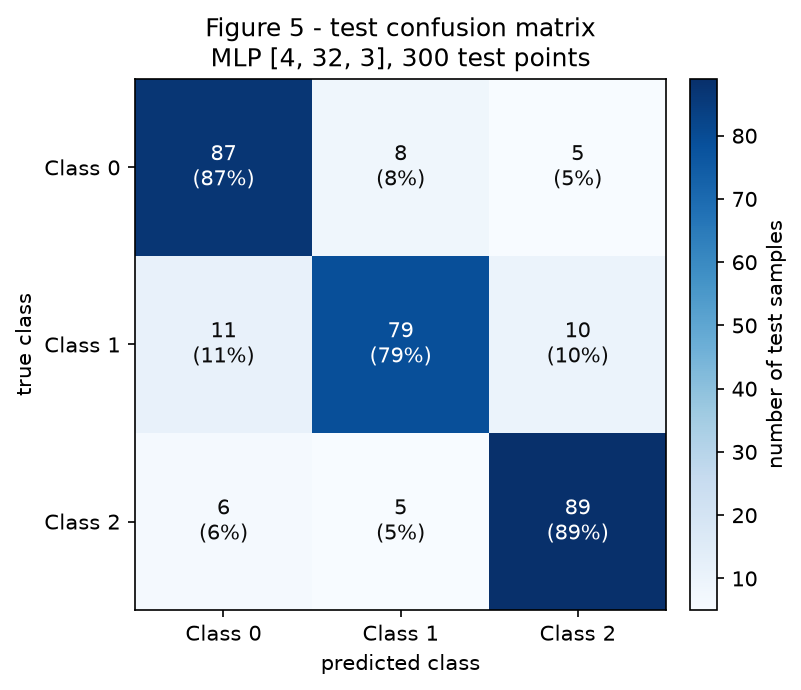
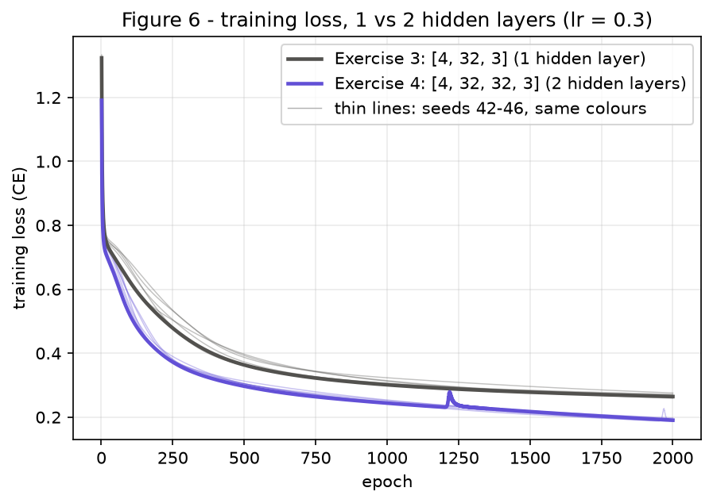

# 3. MLP

This report follows the statement's thread: **what does a hidden layer buy you?** Exercise 1 runs one step of
backpropagation by hand. Exercise 2 trains an MLP on a binary dataset that no straight line can separate.
Exercise 3 reuses the same network, unchanged, for three classes. Exercise 4 checks whether a second hidden
layer helps.

- **Statement:** [Exercises → 3. MLP (2026.2)](https://insper.github.io/ann-dl/2026.2/exercises/mlp/){:target='_blank'}
- **How to re-run:** from the repository root, `python docs/exercises/mlp/code/main.py`. It takes about a
  minute on a laptop CPU. It prints every number quoted below, one labelled line each, and rewrites
  `figures/fig1.png` … `fig6.png`. Two runs give identical output.
- **Code:** [`code/mlp.py`](code/mlp.py) (the MLP, written from scratch in NumPy),
  [`code/main.py`](code/main.py) (data, baselines, training, figures) and
  [`code/check_backprop.py`](code/check_backprop.py) (a numerical check of Exercise 1). Libraries: `numpy`
  and `matplotlib`. `scikit-learn` is used only for `make_blobs`, `make_classification`,
  `train_test_split`, `confusion_matrix` and the `LogisticRegression` baselines the statement allows.
- **Seed policy:** `main.py` creates **one** generator, `rng = np.random.default_rng(42)`, and passes it
  through Exercises 2 → 3 → 4 in order. Every weight initialisation draws from it. The datasets use
  `random_state=42` exactly as the statement gives them. The one exception is the multi-seed comparison of
  Exercise 4B, which the statement asks for. There, both architectures are initialised with the same explicit
  seeds, 42, 43, 44, 45 and 46. Training is full-batch gradient descent with no shuffling, so the initial
  weights are the only thing a seed changes.
- **Notation:** the statement writes $W^{(1)}, W^{(2)}$, and the
  [lecture](https://insper.github.io/ann-dl/2026.2/classes/mlp/){:target='_blank'} writes the same
  two-layer network as $W, V$. So $W^{(1)} \equiv W$, $W^{(2)} \equiv V$, $b^{(1)} \equiv b_h$ and
  $b^{(2)} \equiv b_y$. Row $i$ of $W^{(l)}$ holds the weights of neuron $i$, so $z = Wx + b$.

**Design decisions**, shared by Exercises 2–4:

1. **One class, `MLP(layer_sizes, hidden_activation="tanh", output="sigmoid" | "softmax", rng)`.** The layer
   sizes are a list argument. `output` selects the output activation together with its matching loss:
   sigmoid with binary cross-entropy, or softmax with categorical cross-entropy.
2. **Full-batch gradient descent** with a fixed learning rate. The training loss is recorded at every epoch.
3. **Xavier/Glorot-normal initialisation**, $w \sim \mathcal N\!\left(0,\, 2/(n_\text{in}+n_\text{out})\right)$,
   with zero biases. This scale keeps tanh units out of saturation at the start.
4. **Inputs are standardised with the TRAIN mean and standard deviation.** The test set and the plotting grid
   go through the same transform, never through their own statistics.
5. **The test set is used once, for the final numbers.** The hidden width and the learning rate are chosen on
   a validation split carved out of the training set: 75 % fit, 25 % validation, stratified,
   `random_state=42`. The rule is lowest validation cross-entropy.

## Exercise 1

*One step of backpropagation, by hand.* The network has 2 inputs, 2 tanh hidden units, 1 tanh output and the
loss $L = (y-\hat y)^2$ with $N = 1$. Every quantity below is derived symbolically first and then evaluated.
Values are rounded to 6 decimals, above the 4 the statement asks for. Each value is computed from the
unrounded value before it, so redoing a step from the rounded figures can change the last digit. The script
`check_backprop.py` repeats the arithmetic and checks every gradient against finite differences. It only
verifies the hand derivation; the derivation below is the deliverable.

Given values: $x = [0.5,\ -0.2]^\top$, $y = 1.0$,
$W^{(1)} = \begin{bmatrix} 0.3 & -0.1 \\ 0.2 & 0.4 \end{bmatrix}$, $b^{(1)} = [0.1,\ -0.2]^\top$,
$W^{(2)} = [0.5,\ -0.3]$, $b^{(2)} = 0.2$, $\eta = 0.3$, and $\tanh'(u) = 1-\tanh^2(u)$.

### A — Forward pass

**1. Hidden pre-activations**, $z^{(1)} = W^{(1)}x + b^{(1)}$:

$$
\begin{aligned}
z^{(1)}_1 &= 0.3(0.5) + (-0.1)(-0.2) + 0.1 = 0.15 + 0.02 + 0.1 = \mathbf{0.270000}\\
z^{(1)}_2 &= 0.2(0.5) + 0.4(-0.2) + (-0.2) = 0.10 - 0.08 - 0.2 = \mathbf{-0.180000}
\end{aligned}
$$

**2. Hidden activations**, $h^{(1)} = \tanh(z^{(1)})$, using $\tanh(z) = \dfrac{e^{2z}-1}{e^{2z}+1}$:

$$
\begin{aligned}
h^{(1)}_1 &= \tanh(0.27) = \frac{e^{0.54}-1}{e^{0.54}+1} = \frac{1.716007-1}{1.716007+1} = \frac{0.716007}{2.716007} = \mathbf{0.263625}\\
h^{(1)}_2 &= \tanh(-0.18) = \frac{e^{-0.36}-1}{e^{-0.36}+1} = \frac{0.697676-1}{0.697676+1} = \frac{-0.302324}{1.697676} = \mathbf{-0.178081}
\end{aligned}
$$

**3. Output pre-activation**, $u^{(2)} = W^{(2)}h^{(1)} + b^{(2)}$:

$$
u^{(2)} = 0.5(0.263625) + (-0.3)(-0.178081) + 0.2 = 0.131812 + 0.053424 + 0.2 = \mathbf{0.385237}
$$

**4. Output and loss:**

$$
\hat y = \tanh(0.385237) = \frac{e^{0.770474}-1}{e^{0.770474}+1} = \frac{2.160789-1}{2.160789+1} = \frac{1.160789}{3.160789} = \mathbf{0.367247}
$$

$$
L = (y - \hat y)^2 = (1 - 0.367247)^2 = 0.632753^2 = \mathbf{0.400377}
$$

The output starts far from the target: $\hat y = 0.3672$ against $y = 1$.

### B — Backward pass

Each gradient applies the chain rule to the one before it. The symbolic form comes first, then the numbers.

**1. Output pre-activation, $\partial L/\partial u^{(2)}$.** Start from the loss with respect to the output.
From $L = (y-\hat y)^2$:

$$
\frac{\partial L}{\partial \hat y} = -2\,(y - \hat y) = -2(0.632753) = \mathbf{-1.265507}
$$

Then apply the tanh derivative: $\hat y = \tanh(u^{(2)})$, so $\dfrac{\partial \hat y}{\partial u^{(2)}} = 1-\hat y^{2}$, with
$\hat y^2 = 0.367247^2 = 0.134870$:

$$
\begin{aligned}
\delta^{(2)} \equiv \frac{\partial L}{\partial u^{(2)}} &= \frac{\partial L}{\partial \hat y}\,(1-\hat y^2)\\
&= -1.265507 \times (1 - 0.134870) = -1.265507 \times 0.865130 = \mathbf{-1.094828}
\end{aligned}
$$

**2. Output layer, $\partial L/\partial W^{(2)}$ and $\partial L/\partial b^{(2)}$.** $u^{(2)} = \sum_j W^{(2)}_j h^{(1)}_j + b^{(2)}$, so $\partial u^{(2)}/\partial W^{(2)}_j = h^{(1)}_j$ and
$\partial u^{(2)}/\partial b^{(2)} = 1$:

$$
\frac{\partial L}{\partial W^{(2)}} = \delta^{(2)}\, h^{(1)\top}
= -1.094828 \times [0.263625,\ -0.178081] = [\mathbf{-0.288624},\ \mathbf{0.194968}]
$$

$$
\frac{\partial L}{\partial b^{(2)}} = \delta^{(2)} = \mathbf{-1.094828}
$$

**3. Propagate back, $\partial L/\partial h^{(1)}$ and $\partial L/\partial z^{(1)}$.** First the hidden activations:
$\partial u^{(2)}/\partial h^{(1)}_j = W^{(2)}_j$, so

$$
\frac{\partial L}{\partial h^{(1)}} = \delta^{(2)}\, W^{(2)\top}
= -1.094828 \times [0.5,\ -0.3] = [\mathbf{-0.547414},\ \mathbf{0.328448}]
$$

Then the hidden pre-activations: $h^{(1)}_j = \tanh(z^{(1)}_j)$, so $\partial h^{(1)}_j / \partial z^{(1)}_j = 1-(h^{(1)}_j)^2$. Here
$(h^{(1)})^2 = [0.069498,\ 0.031713]$ and $1-(h^{(1)})^2 = [0.930502,\ 0.968287]$. Element by element:

$$
\begin{aligned}
\delta^{(1)} \equiv \frac{\partial L}{\partial z^{(1)}} &= \frac{\partial L}{\partial h^{(1)}} \odot \left(1-(h^{(1)})^2\right)\\
&= [-0.547414 \times 0.930502,\ \ 0.328448 \times 0.968287] = [\mathbf{-0.509370},\ \mathbf{0.318032}]
\end{aligned}
$$

**4. Hidden layer, $\partial L/\partial W^{(1)}$ and $\partial L/\partial b^{(1)}$.** $z^{(1)}_i = \sum_j W^{(1)}_{ij}x_j + b^{(1)}_i$, so $\partial z^{(1)}_i / \partial W^{(1)}_{ij} = x_j$ and
$\partial z^{(1)}_i/\partial b^{(1)}_i = 1$. This gives the outer product $\delta^{(1)} x^\top$:

$$
\frac{\partial L}{\partial W^{(1)}} = \delta^{(1)} x^\top =
\begin{bmatrix} -0.509370(0.5) & -0.509370(-0.2) \\ 0.318032(0.5) & 0.318032(-0.2) \end{bmatrix}
= \begin{bmatrix} \mathbf{-0.254685} & \mathbf{0.101874} \\ \mathbf{0.159016} & \mathbf{-0.063606} \end{bmatrix}
$$

$$
\frac{\partial L}{\partial b^{(1)}} = \delta^{(1)} = [\mathbf{-0.509370},\ \mathbf{0.318032}]
$$

**Check.** `check_backprop.py` recomputes the gradients with NumPy and compares each of the 9 scalar gradients
with a central finite difference $\big(L(\theta+\epsilon)-L(\theta-\epsilon)\big)/2\epsilon$, $\epsilon = 10^{-6}$.
The largest disagreement is $8.3 \times 10^{-11}$.

``` { .python .copy linenums='1' title="check_backprop.py — the same chain rule in NumPy (verification only)" }
--8<-- "docs/exercises/mlp/code/check_backprop.py:forward_backward"
```

### C — Parameter update

Gradient descent applies $\theta \leftarrow \theta - \eta\,\partial L/\partial\theta$ with $\eta = 0.3$. The four update
rules cover nine scalars: 2 in $W^{(2)}$, 1 in $b^{(2)}$, 4 in $W^{(1)}$ and 2 in $b^{(1)}$. All nine are listed.

**Output layer:**

$$
\begin{aligned}
W^{(2)} &\leftarrow [0.5,\ -0.3] - 0.3\,[-0.288624,\ 0.194968]\\
&= [0.5 + 0.086587,\ -0.3 - 0.058490] = [\mathbf{0.586587},\ \mathbf{-0.358490}]\\[4pt]
b^{(2)} &\leftarrow 0.2 - 0.3\,(-1.094828) = 0.2 + 0.328448 = \mathbf{0.528448}
\end{aligned}
$$

**Hidden layer:**

$$
\begin{aligned}
W^{(1)} &\leftarrow \begin{bmatrix} 0.3 & -0.1 \\ 0.2 & 0.4 \end{bmatrix} - 0.3\begin{bmatrix} -0.254685 & 0.101874 \\ 0.159016 & -0.063606 \end{bmatrix}\\[4pt]
&= \begin{bmatrix} 0.3 + 0.076405 & -0.1 - 0.030562 \\ 0.2 - 0.047705 & 0.4 + 0.019082 \end{bmatrix}
= \begin{bmatrix} \mathbf{0.376405} & \mathbf{-0.130562} \\ \mathbf{0.152295} & \mathbf{0.419082} \end{bmatrix}\\[6pt]
b^{(1)} &\leftarrow [0.1,\ -0.2] - 0.3\,[-0.509370,\ 0.318032]\\
&= [0.1 + 0.152811,\ -0.2 - 0.095410] = [\mathbf{0.252811},\ \mathbf{-0.295410}]
\end{aligned}
$$

**Does the loss go up or down? Down.** A second forward pass with the updated parameters proves it:

$$
\begin{aligned}
z^{(1)}_1 &= 0.376405(0.5) + (-0.130562)(-0.2) + 0.252811\\
&= 0.188203 + 0.026112 + 0.252811 = 0.467126\\
z^{(1)}_2 &= 0.152295(0.5) + 0.419082(-0.2) - 0.295410\\
&= 0.076148 - 0.083816 - 0.295410 = -0.303079\\
h^{(1)} &= \tanh(z^{(1)}) = [0.435874,\ -0.294127]\\
u^{(2)} &= 0.586587(0.435874) + (-0.358490)(-0.294127) + 0.528448\\
&= 0.255678 + 0.105442 + 0.528448 = 0.889568\\
\hat y &= \tanh(0.889568) = 0.711181, \qquad L = (1 - 0.711181)^2 = 0.288819^2 = \mathbf{0.083417}
\end{aligned}
$$

The loss falls from $0.400377$ to $0.083417$, a change of $-0.316960$ ($-79.17\,\%$). The reason is that
every parameter moved against its own gradient. To first order,
$L(\theta - \eta g) \approx L(\theta) - \eta\,\lVert g\rVert^2$, and $\lVert g\rVert^2 = 1.785141 > 0$, so a
small enough step must lower the loss. The first-order estimate, $-0.3 \times 1.785141 = -0.535542$, is larger
than the true drop because tanh curves the loss surface. A much larger $\eta$ could overshoot, but
$\eta = 0.3$ does not, as the second pass shows. The individual moves all push $\hat y$ up toward
$y = 1$:

- $b^{(2)}$ rose by $0.328448$.
- $W^{(2)}_1$ rose where $h^{(1)}_1 > 0$, and $W^{(2)}_2$ fell where $h^{(1)}_2 < 0$, so both products
  $W^{(2)}_j h^{(1)}_j$ grew.
- The hidden parameters made $h^{(1)}_1$ larger (0.2636 → 0.4359) and $h^{(1)}_2$ more negative
  (−0.1781 → −0.2941).

Together, $u^{(2)}$ goes from 0.3852 to 0.8896.

## Exercise 2

*Binary classification a straight line cannot do.* I generate the statement's three blobs and split them 80/20
with stratification. A logistic-regression baseline comes first. Then the hand-written `MLP` class is trained
with a sigmoid output and binary cross-entropy. The hidden width and learning rate are picked on a validation
split, and the test set is evaluated once. Item D explains the gap between the two models from the shape of the
region in Figure 3.

### A — Generate the data

The generator call is the statement's, unchanged. The split is
`train_test_split(..., test_size=0.2, random_state=42, stratify=y)`. It gives 800 training and 200 test points,
with 400/400 and 100/100 per class. In the test split, class 1 comes 42 points from the $(3,3)$ cluster and 58
from the $(-3,-3)$ cluster. Item D uses that imbalance.

``` { .python .copy linenums='1' title="main.py — data generation and split" }
--8<-- "docs/exercises/mlp/code/main.py:ex2_data"
```

``` { .python .copy linenums='1' title="main.py — standardisation and hyper-parameter selection helpers" }
--8<-- "docs/exercises/mlp/code/main.py:helpers"
```


/// caption
**Figure 1** — All 1000 points, coloured by class. Class 1 (orange, 500 points) is two clusters at $(3,3)$ and $(-3,-3)$ on either side of class 0 (blue, 500 points) at the origin. Crosses mark the generator's centres.
///

### B — Establish the baseline

A single linear boundary is fitted to the training set with `LogisticRegression`, on the same standardised
inputs the MLP sees.

``` { .python .copy linenums='1' title="main.py — linear baseline" }
--8<-- "docs/exercises/mlp/code/main.py:ex2_baseline"
```

**Baseline test accuracy: 47.5 %** (95 of 200), worse than guessing. Its training accuracy is 53.25 %. The fitted
weights are almost zero: $w = [0.0728,\ 0.0044]$ on standardised inputs, with bias $0.0000$. On the test set,
the predicted $P(\text{class }1)$ only ranges over $[0.457,\ 0.543]$. Item D explains why.

### C — Implement the MLP

**Implementation.** Everything below is NumPy written by hand: activations, losses, forward pass, gradients and
update. The forward pass caches every layer's activation, $A^{(0)} = X$ and
$A^{(l+1)} = f\!\left(A^{(l)}W^{(l)\top} + b^{(l)}\right)$. The backward pass starts from the output delta
$\delta = (\hat Y - Y)/N$ and runs these steps for each layer:

$$
\frac{\partial L}{\partial W^{(l)}} = \delta^{(l)\top} A^{(l)},\qquad
\frac{\partial L}{\partial b^{(l)}} = \textstyle\sum_n \delta^{(l)}_n,\qquad
\delta^{(l-1)} = \left(\delta^{(l)} W^{(l)}\right) \odot f'\!\left(A^{(l)}\right).
$$

This is Exercise 1's chain rule vectorised over $N$ samples and any number of layers.

**Why the output delta is $\hat y - y$.** Take a sigmoid output with binary cross-entropy:
$\hat y = \sigma(u)$ and $L = -[y\log\hat y + (1-y)\log(1-\hat y)]$. Then

$$
\frac{\partial L}{\partial \hat y} = -\frac{y}{\hat y} + \frac{1-y}{1-\hat y} = \frac{\hat y - y}{\hat y(1-\hat y)},
\qquad \frac{\partial \hat y}{\partial u} = \sigma(u)\big(1-\sigma(u)\big) = \hat y(1-\hat y),
$$

and multiplying the two gives

$$
\frac{\partial L}{\partial u} = \frac{\hat y - y}{\hat y(1-\hat y)}\cdot \hat y(1-\hat y) = \hat y - y .
$$

Averaging over the batch adds the factor $1/N$. Exercise 3B shows that softmax with categorical cross-entropy
gives the same expression. That is why `backward()` has no branch on the task.

``` { .python .copy linenums='1' title="mlp.py — activations" }
--8<-- "docs/exercises/mlp/code/mlp.py:activations"
```

``` { .python .copy linenums='1' title="mlp.py — losses and output heads" }
--8<-- "docs/exercises/mlp/code/mlp.py:losses"
```

``` { .python .copy linenums='1' title="mlp.py — constructor: layer sizes are an argument" }
--8<-- "docs/exercises/mlp/code/mlp.py:init"
```

``` { .python .copy linenums='1' title="mlp.py — forward pass" }
--8<-- "docs/exercises/mlp/code/mlp.py:forward"
```

``` { .python .copy linenums='1' title="mlp.py — backward pass" }
--8<-- "docs/exercises/mlp/code/mlp.py:backward"
```

``` { .python .copy linenums='1' title="mlp.py — gradient-descent update and training loop" }
--8<-- "docs/exercises/mlp/code/mlp.py:step"

--8<-- "docs/exercises/mlp/code/mlp.py:fit"
```

??? example "Full source of `mlp.py`, including `predict`, `one_hot` and the finite-difference `gradient_check`"

    ``` { .python .copy linenums='1' title="mlp.py" }
    --8<-- "docs/exercises/mlp/code/mlp.py"
    ```

**Correctness check.** `gradient_check` perturbs every weight and bias of the trained network by $\pm 10^{-6}$
and compares the numerical gradient with `backward()`. For the sigmoid + BCE network the largest absolute
difference is $2.2 \times 10^{-11}$.

**Choosing the hyper-parameters.** All candidates train for 2000 full-batch epochs on 600 training points and
are scored on the 200 held-out training points:

| hidden units | η = 0.1: val. acc / val. loss | η = 0.5: val. acc / val. loss |
| --- | --- | --- |
| 4 | 95.0 % / 0.1403 | 95.0 % / 0.1474 |
| 8 | 95.0 % / **0.1391** | 95.0 % / 0.1502 |
| 16 | 95.0 % / 0.1425 | 95.0 % / 0.1514 |

Every candidate ties at 95.0 % validation accuracy, which is why the selection rule uses the validation loss
instead. The winner is 8 hidden units with $\eta = 0.1$. It is then retrained on all 800 training points.

``` { .python .copy linenums='1' title="main.py — selection, final training, test accuracy" }
--8<-- "docs/exercises/mlp/code/main.py:ex2_train"
```

**1. Result.**

| | |
| --- | --- |
| Architecture | `[2, 8, 1]`: 2 inputs → 8 tanh units → 1 sigmoid output, 33 parameters |
| Loss | binary cross-entropy |
| Learning rate | $\eta = 0.1$ |
| Epochs | 2000, full batch |
| Training loss | 0.6945 at epoch 1 → **0.1150** at epoch 2000 |
| Training accuracy | 96.37 % |
| **Test accuracy** | **92.0 %** (184 of 200), inside the 90–93 % reference range |

**2. Training loss.** The loss sits near $\ln 2 = 0.693$ at first, the value for a network that outputs 0.5
everywhere. It falls fastest between epochs 50 and 400: 0.5280 at epoch 100 and 0.1624 at epoch 500. From
there it flattens toward 0.115. Training longer would gain little, because the remaining errors sit where the
clusters overlap (Figure 3).


/// caption
**Figure 2** — Binary cross-entropy on the 800 training points at each of the 2000 epochs, MLP `[2, 8, 1]`, $\eta = 0.1$.
///

**3. Decision boundary.** The network is evaluated on a 400 × 400 grid covering the test points. The grid goes
through the same train-statistics standardisation, and each predicted region is shaded.

``` { .python .copy linenums='1' title="main.py — grid evaluation for Figure 3" }
--8<-- "docs/exercises/mlp/code/main.py:ex2_grid"
```


/// caption
**Figure 3** — Predicted regions of the MLP over the 200 test points (blue = class 0, orange = class 1). The solid line is the MLP's $P = 0.5$ boundary, × marks its 16 test errors, and the dashed line is the logistic-regression boundary.
///

### D — Analysis

**The shape of the class-1 region (Figure 3).** The MLP assigns class 1 to **two disconnected regions**, one in
the lower-left corner and one in the upper-right. Between them runs a **band of class 0** along the
anti-diagonal. The band's two edges are nearly straight and nearly parallel. Along the diagonal
$x_1 = x_2 = s$, which passes through all three cluster centres, the prediction switches from class 1 to
class 0 at $s = -1.613$ and back to class 1 at $s = 1.721$. The band is therefore 4.715 units wide, centred on
the class-0 cluster, and class 1 covers 56.5 % of the plotted area. On the test set the MLP is right on 94 % of
the origin cluster, 93 % of the $(3,3)$ cluster and 88 % of the $(-3,-3)$ cluster. 14 of its 16 errors (×) lie
within 0.85 of an edge, where the Gaussian tails overlap. The other two are class-1 tail points, at
$(-0.92, -0.32)$ and $(-1.58, 0.11)$, which sit 1.4 and 1.2 units inside the band.

**Why no single straight line can produce it.** A line splits the plane into two half-planes, and a half-plane
is convex: it contains the whole segment between any two of its points. Class 1 sits at $(-3,-3)$ and $(3,3)$,
and the segment between them passes through $(0,0)$, the centre of class 0. A half-plane that holds both
class-1 clusters therefore also holds the class-0 cluster. Any line must misclassify at least one entire
cluster: either one class-1 cluster lands on the class-0 side, or class 0 lands on the class-1 side. Even the
best possible line gives up a quarter of the data, about 75 % accuracy. The MLP gets past this because each
tanh unit draws its own line. The output unit combines two roughly parallel lines, "above the upper edge" OR
"below the lower edge", and so builds a band, which is not convex.

**Why the baseline lands below 50 %, not at 75 %.** Logistic regression maximises likelihood, not accuracy.
The two class-1 clusters are mirror images through the origin, so the class-1 mean and the class-0 mean almost
coincide: $(0.206, 0.205)$ against $(0.017, 0.055)$ on the training set. Tilting the line toward one class-1
cluster costs as much likelihood on the other as it gains. The optimum is therefore a nearly flat model, with
$\lVert w\rVert \approx 0.07$ and test probabilities between 0.457 and 0.543. Where its boundary falls is
decided by sampling noise. The dashed line in Figure 3 is almost vertical, $x_1 = 0.119 - 0.060\,x_2$. It
passes through the middle of the class-0 cluster, so on the test set:

| test cluster | points | predicted class 1 | baseline accuracy |
| --- | --- | --- | --- |
| class 0, origin | 100 | 47 % | 53 % |
| class 1, $(3,3)$ | 42 | 100 % | 100 % |
| class 1, $(-3,-3)$ | 58 | 0 % | 0 % |
| **total** | 200 | | **(53 + 42 + 0) / 200 = 47.5 %** |

The baseline cuts class 0 in half and gets one class-1 cluster entirely right and the other entirely wrong. The
test split happens to hold more points from the cluster it gets wrong (58 against 42), so the result falls
below 50 %. On the training split the same line scores 53.25 %. The failure is geometric: class 1 sits on both
sides of class 0, and the MLP's two-edged band in Figure 3 is exactly the shape a single line cannot draw. That
moves accuracy from 47.5 % to 92.0 %.

## Exercise 3

*Multi-class, same network.* The statement's `make_classification` call produces 1500 points in 4-D, with
3 classes of 2 clusters each. The Exercise 2 class is reused **without editing a line**: only the constructor
arguments change, to 3 outputs and `output="softmax"`, which brings in categorical cross-entropy. Width and
learning rate are again chosen on a validation split. For item D, I recover the 6 generating clusters and
measure how far apart they are.

### A — Generate the data

The generator call is unchanged from the statement. The split is 80/20 with `random_state=42` and
`stratify=y`. It gives 1200 training and 300 test points, with 399/399/402 and 100/100/100 per class. The
features are already close to unit scale (train standard deviations 1.48–1.63), but they are standardised
with the train statistics as in Exercise 2.

``` { .python .copy linenums='1' title="main.py — data generation and split" }
--8<-- "docs/exercises/mlp/code/main.py:ex3_data"
```

### B — Adapt the network

**Changes from Exercise 2:** the output layer has 3 units, softmax turns them into probabilities, and
categorical cross-entropy replaces BCE. In code this is the constructor call
`MLP([4, 32, 3], output="softmax", rng=rng)` and one-hot targets. `softmax` and
`categorical_cross_entropy` are already in the `activations` and `losses` blocks shown in Exercise 2C.

**Derivation of $\partial L/\partial u$ for softmax + cross-entropy.** For one sample with logits
$u \in \mathbb R^K$ and a one-hot target $y$:

$$
\hat y_k = \frac{e^{u_k}}{\sum_{m} e^{u_m}}, \qquad L = -\sum_{k} y_k \log \hat y_k .
$$

*Step 1, the softmax Jacobian.* Write $S = \sum_m e^{u_m}$ and apply the quotient rule:

$$
\frac{\partial \hat y_k}{\partial u_j} =
\begin{cases}
\dfrac{e^{u_k} S - e^{u_k} e^{u_k}}{S^2} = \hat y_k (1-\hat y_k), & j = k\\[10pt]
\dfrac{0\cdot S - e^{u_k} e^{u_j}}{S^2} = -\hat y_k \hat y_j, & j \neq k
\end{cases}
$$

so that

$$
\frac{\partial \hat y_k}{\partial u_j} = \hat y_k(\delta_{kj} - \hat y_j),
\qquad J = \operatorname{diag}(\hat y) - \hat y \hat y^\top .
$$

*Step 2, the loss with respect to the probabilities:* $\dfrac{\partial L}{\partial \hat y_k} = -\dfrac{y_k}{\hat y_k}$.

*Step 3, the chain rule summed over every output $k$:*

$$
\frac{\partial L}{\partial u_j} = \sum_k \frac{\partial L}{\partial \hat y_k}\frac{\partial \hat y_k}{\partial u_j}
= \sum_k \left(-\frac{y_k}{\hat y_k}\right)\hat y_k(\delta_{kj} - \hat y_j)
= -y_j + \hat y_j \sum_k y_k = \boxed{\hat y_j - y_j},
$$

using $\sum_k y_k = 1$. In vector form, $\nabla_u L = J^\top \nabla_{\hat y} L = \hat y - y$. Over a batch the mean
adds $1/N$.

**Why it is so simple.** The $1/\hat y_k$ from the logarithm cancels the $\hat y_k$ factor in the softmax
Jacobian, because the log undoes the exponential. The gradient that remains is the prediction error, bounded
in $[-1, 1]$. It stays large when a confident prediction is wrong. Compare Exercise 1, MSE with tanh, where
$\partial L/\partial u = -2(y-\hat y)(1-\hat y^2)$ keeps the activation derivative: a saturated, wrong output
gets almost no gradient there. Sigmoid with BCE (Exercise 2C) is the $K = 2$ case of the same result.

!!! success "Extra point — the Exercise 2 code is reused verbatim"

    Exercises 2, 3 and 4 run **the same `MLP.forward`, `MLP.backward`, `MLP.step` and `MLP.fit`**, the
    blocks shown in Exercise 2C, from the single file `code/mlp.py`, untouched. The three exercises differ
    only in constructor arguments:

    | | constructor call | output head (activation + loss) |
    | --- | --- | --- |
    | Exercise 2 | `MLP([2, 8, 1], output="sigmoid", rng=rng)` | sigmoid + binary cross-entropy |
    | Exercise 3 | `MLP([4, 32, 3], output="softmax", rng=rng)` | softmax + categorical cross-entropy |
    | Exercise 4 | `MLP([4, 32, 32, 3], output="softmax", rng=rng)` | softmax + categorical cross-entropy |

    The design rests on the derivation above. Both heads are canonical pairs, so the output delta is
    $(\hat Y - Y)/N$ in both cases, and `backward()` does not contain a single `if` about the task. The task
    enters only through the `OUTPUT` dictionary, which picks the activation and loss functions. `forward()`
    calls whichever activation was picked. The finite-difference check confirms that the shared code is
    correct for all three networks, with largest differences of $2.2\times10^{-11}$ (sigmoid + BCE),
    $8.8\times10^{-11}$ (softmax + CE) and $7.4\times10^{-11}$ (two hidden layers).

### C — Train and evaluate

**Choosing the hyper-parameters.** Each candidate trains for 2000 epochs on 900 training points and is scored
on 300 held-out training points:

| hidden units | η = 0.1 | η = 0.3 | η = 0.5 |
| --- | --- | --- | --- |
| 8 | 81.7 % / 0.4443 | 84.3 % / 0.4718 | 85.0 % / 0.4511 |
| 16 | 83.3 % / 0.4401 | 87.3 % / 0.4127 | 85.3 % / 0.4394 |
| 32 | 86.0 % / 0.4030 | 87.0 % / **0.3849** | 88.0 % / 0.4319 |

*(Each cell gives validation accuracy / validation loss.)* The lowest validation loss is 32 hidden units with
$\eta = 0.3$. The network is retrained on all 1200 training points.

``` { .python .copy linenums='1' title="main.py — same class, softmax head, final training and confusion matrix" }
--8<-- "docs/exercises/mlp/code/main.py:ex3_train"
```

**1. Result.**

| | |
| --- | --- |
| Architecture | `[4, 32, 3]`: 4 inputs → 32 tanh units → 3 softmax outputs, 259 parameters |
| Loss | categorical cross-entropy |
| Learning rate | $\eta = 0.3$ |
| Epochs | 2000, full batch |
| Training loss | 1.3241 at epoch 1 → **0.2644** at epoch 2000 |
| Training accuracy | 90.58 % |
| **Test accuracy** | **85.0 %** (255 of 300), inside the 83–86 % reference range |

**2. Training loss.** The initial loss of 1.3241 sits above $\ln 3 = 1.099$ because the random initial logits
are not uniform. In about 20 epochs it drops to a shoulder near 0.75, where the network separates the easy
clusters. It then declines slowly: 0.6239 at epoch 100, 0.3633 at epoch 500 and 0.2644 at epoch 2000, still
creeping down at the end.


/// caption
**Figure 4** — Categorical cross-entropy on the 1200 training points at each of the 2000 epochs, MLP `[4, 32, 3]`, $\eta = 0.3$.
///

**3. Confusion matrix.**


/// caption
**Figure 5** — Test-set confusion matrix of the `[4, 32, 3]` network. Rows are true classes and columns are predictions; each cell shows the count and the row percentage. There are 45 errors in 300 points.
///

### D — Analysis

**Most-confused pair: class 0 and class 1.** In Figure 5 the off-diagonal sums are:

- class 0 ↔ class 1: 8 + 11 = **19 confusions**, 42 % of the 45 test errors;
- class 1 ↔ class 2: 10 + 5 = 15;
- class 0 ↔ class 2: 5 + 6 = 11.

Class 1 also has the lowest recall, 79 %, against 87 % for class 0 and 89 % for class 2.

**Explanation from the cluster structure.** `make_classification` puts the 6 cluster centres on vertices of a
4-D hypercube with side $2 \times$ `class_sep` $= 2$. It draws 250 points per cluster, in order, gives each
cluster a random covariance, and only shuffles rows and columns at the end, after every random draw. Calling it
again with `shuffle=False` therefore returns the same points in generation order. Matching rows recovers the
cluster each point came from, C0 to C5, with class equal to the index mod 3. This is used for analysis only;
the network never sees it.

``` { .python .copy linenums='1' title="main.py — recovering the generating cluster of each point" }
--8<-- "docs/exercises/mlp/code/main.py:ex3_clusters"
```

| cluster | class | centroid (sign pattern) | RMS radius | MLP test acc. | LR test acc. |
| --- | --- | --- | --- | --- | --- |
| C0 | 0 | − − − − | 2.54 | 86 % | 80 % |
| C1 | 1 | − + − − | **2.71** (widest) | **65 %** | 51 % |
| C2 | 2 | − + − + | 2.45 | 80 % | 41 % |
| C3 | 0 | + − + + | 2.47 | 88 % | 80 % |
| C4 | 1 | − + + + | **1.81** (tightest) | 96 % | 65 % |
| C5 | 2 | + + + − | 2.45 | 93 % | 77 % |

Clusters of different classes that differ in **one** coordinate are hypercube neighbours, with centroids about
2 apart. Other inter-class pairs are at least 2.67 apart. Projecting each neighbouring pair on the axis between
their centroids, 15–18 % of their points fall past the midpoint:

| class pair | neighbouring clusters (centroid distance, overlap past the midpoint) | test confusions |
| --- | --- | --- |
| 0 ↔ 1 | C0–C1 (2.03, 15.2 %) | **19** |
| 1 ↔ 2 | C2–C4 (1.92, 16.8 %), C1–C2 (2.08, 18.0 %) | 15 |
| 0 ↔ 2 | none; the closest pair, C0–C2, is 2.96 apart | 11 |

The ranking follows this structure. Class 0 ↔ class 2 has no neighbouring clusters and the fewest
confusions. The two other pairs each share an edge, and the most-confused pair (0, 1) shares edge C0–C1.
**C1, the widest cluster in the data with an RMS radius of 2.71, sits on that edge.** C1 also touches C2, a
class-2 cluster, so it is the cluster wedged between the other two classes. It is the hardest cluster in
Figure 5: only 65 % correct, with 10 of its 49 test points called class 0 and 7 called class 2. On paper,
class 1 ↔ 2 has two edges against one, but its second edge, C2–C4, involves C4, the tightest cluster (RMS
radius 1.81). C4 stays 96 % correct, so that edge leaks little and the pair ends second with 15 confusions.
A small irreducible part comes from the generator's default `flip_y=0.01`, which reassigned 11 labels at
random: 9 in train and 2 in test.

**Baseline comparison.** Logistic regression on the same standardised inputs reaches **66.3 %**. The MLP
reaches 85.0 %, **18.67 points higher**. The baseline's errors fall where the clusters interleave: it confuses
class 1 and class 2 57 times (32 + 25), against 15 for the MLP. It is worst on C2 (41 %) and C1 (51 %), and
holds class 0 at 80 %. The reason is again convexity. A linear softmax classifier gives each class a convex
region, so if both centres of a class are classified correctly, the whole segment between them is too. The
segment from C1 to C4, class 1's two centres, passes only 1.49 from the centre of C2 (class 2, RMS radius
2.45). The segment from C2 to C5, class 2's two centres, passes 1.56 from C1 and 1.59 from C4, both class 1.
Each class's segment runs through the bulk of the other class's cluster, so a linear model cannot keep both
clusters of class 1 and both of class 2. Class 0's segment, C0 to C3, stays at least 2.03 from every
other-class centre, which is why the baseline does fine on class 0.

**What the hidden layer adds** is non-convex class regions. With 32 tanh units the network can shape each
class as a union of two separate blobs, one per cluster. The clusters the baseline sacrifices recover most:
C2 goes from 41 % to 80 %, C4 from 65 % to 96 % and C1 from 51 % to 65 %. What is left is overlap the data
itself contains.

## Exercise 4

*Does a second hidden layer help?* The setup keeps the Exercise 3 data, split, standardisation, learning rate
($\eta = 0.3$), number of epochs (2000), hidden width (32) and code. The only change is a second hidden layer.
One run uses the report's shared `rng`, for Figure 6. The controlled comparison trains **both** architectures
from the same five explicit seeds, 42–46, and compares means and per-seed pairs.

### A — Train the deeper network

``` { .python .copy linenums='1' title="main.py — the only change is depth" }
--8<-- "docs/exercises/mlp/code/main.py:ex4_train"
```

| | |
| --- | --- |
| Architecture | `[4, 32, 32, 3]`: 4 inputs → 32 tanh → 32 tanh → 3 softmax, 1315 parameters (259 in Exercise 3) |
| Learning rate, epochs | $\eta = 0.3$, 2000 full-batch epochs, the same as Exercise 3 |
| Training loss | 1.1914 at epoch 1 → **0.1904** at epoch 2000 (Exercise 3: 0.2644) |
| Training accuracy | 94.00 % (Exercise 3: 90.58 %) |
| **Test accuracy** | **86.0 %** (258 of 300); the Exercise 3 network scored 85.0 % in its shared-`rng` run |

That single comparison favours depth by 1.0 point, but one run per model only compares two initialisations.
Item B shows that the sign does not hold up.

### B — Compare

``` { .python .copy linenums='1' title="main.py — multi-seed controlled comparison" }
--8<-- "docs/exercises/mlp/code/main.py:ex4_seeds"
```


/// caption
**Figure 6** — Training loss of the Exercise 3 network (gray, `[4, 32, 3]`) and the Exercise 4 network (violet, `[4, 32, 32, 3]`) on the same axes, same data, $\eta = 0.3$ and 2000 epochs. Thick lines are the shared-`rng` runs and thin lines are the seed 42–46 runs.
///

**Comparison table**, mean ± sample standard deviation over seeds 42–46:

| | hidden layers | parameters | final train loss | test accuracy |
| --- | --- | --- | --- | --- |
| Exercise 3 | 1 | 259 | 0.2674 ± 0.0068 | **85.87 % ± 0.77** |
| Exercise 4 | ≥ 2 (here 2) | 1315 | 0.1899 ± 0.0044 | **85.53 % ± 0.38** |

Per seed, with the initialisation seed shared by both networks:

| seed | test acc., 1 hidden layer | test acc., 2 hidden layers | difference (2 − 1) | final loss, 1 layer | final loss, 2 layers |
| --- | --- | --- | --- | --- | --- |
| 42 | 85.33 % | 85.33 % | 0.00 | 0.2757 | 0.1885 |
| 43 | 87.00 % | 85.67 % | −1.33 | 0.2591 | 0.1867 |
| 44 | 86.33 % | 86.00 % | −0.33 | 0.2620 | 0.1972 |
| 45 | 85.33 % | 85.00 % | −0.33 | 0.2716 | 0.1868 |
| 46 | 85.33 % | 85.67 % | +0.33 | 0.2686 | 0.1902 |
| **mean** | 85.87 % | 85.53 % | **−0.33 ± 0.62** | 0.2674 | 0.1899 |

With depth, the test accuracy moves by **−0.33 ± 0.62 points**: worse for 3 seeds, tied for 1, better for 1.
On a 300-point test set one point is 3 samples, so the difference is zero within noise. The training loss,
by contrast, is lower with depth for every seed, by 0.065 to 0.087. Training accuracy is 93.48 ± 0.43 % for
the deep network against 90.40 ± 0.48 % for the shallow one.

### C — Analysis

**Result: the second hidden layer does not help on this data.** It reaches a lower training loss and the same
or slightly lower test accuracy. I explain this from the structure of the data.

**1. The data needs few, simple boundaries.** There are 6 roughly Gaussian clusters in 4-D (Exercise 3D). The
boundary between two Gaussians is smooth, at most quadratic. One layer of 32 tanh units is enough to wrap each
cluster in its own region, and the one-layer network already fixes the clusters the linear model loses. To
estimate how much the overlap leaves, I fit one Gaussian per *generating cluster* on the training points and
classify each test point by its most likely cluster. This reference gets the cluster ids, which the networks
never see, so it is a ceiling estimate, not a competitor. It reaches **89.33 %**. The shallow network is 3.47
points below it and the deep one 3.80. The remaining errors come from overlap: 15–18 % of the points on the
three hypercube edges fall past the midpoint, plus 2 flipped test labels. A second layer adds no new
information to separate those points.

**2. What depth adds in representation, and what it costs.** A second layer composes features: it builds new
features out of the first layer's hyperplanes. That can draw very complex regions with few units, but only
when the target region is itself a composition, and six blobs are not. The costs are measurable:

- **Size and compute.** The parameter count grows 5.1× (259 → 1315), and so does the compute per epoch.
- **Stability.** With the same $\eta = 0.3$, the one-layer loss decreased at **every epoch of all six runs**.
  The two-layer loss went **up** in 292 epochs of the shared-`rng` run, including the spike of +0.0130 at epoch
  1217 that is visible in Figure 6. For seed 43 it went up in 20 epochs, all between epochs 1950 and 1971,
  which shows as the spike on the thin violet curve near the right edge of Figure 6 (largest single-epoch
  increase +0.0074, at epoch 1967). Gradient descent is stable only while the
  curvature of the loss stays below about $2/\eta$. Chaining two layers' Jacobians makes the surface sharper,
  so the same step sits closer to that limit for the deeper network. Tuning the deep model's learning rate
  separately would change the comparison, so it was not done.
- **Speed is not the problem here.** The deeper network actually lowers the loss faster: the mean over seeds
  is 0.416 at epoch 200 against 0.553, and 0.249 at epoch 1000 against 0.312. The difficulty is not
  optimisation speed but what the extra fitting is spent on.

**3. Training loss and test accuracy tell opposite stories.** Measured by final training loss, depth "wins"
by 29 %, 0.190 against 0.267. Measured by test accuracy, it loses 0.33 points. The train–test gap widens from
4.5 points (90.40 % → 85.87 %) to 8.0 points (93.48 % → 85.53 %). With 1315 parameters for 1200 training points,
the extra capacity goes into carving the overlap zones of this particular training sample, including its 9
flipped labels. That fits noise and does not transfer to new points. A lower training loss is evidence of
capacity, not of a better model.

**4. What data would reward depth.** Data whose decision regions are *compositions*, where a deep network
reuses intermediate features and a shallow one must enumerate every piece:

- repeated, self-similar patterns, such as stripes or a checkerboard with $2^k$ cells along a direction. A
  single hidden layer needs on the order of one unit per boundary, about $2^k$ units. A deep network can
  fold the input onto itself once per layer, a tent map composed $k$ times, using a few units in each of
  $k$ layers (Telgarsky, 2016);
- spirals with many turns;
- many clusters per class in a higher dimension;
- natural signals such as images, audio and text, where edges compose into textures, textures into parts and
  parts into objects.

Depth also pays off only with enough data, so that the extra parameters learn structure instead of
noise. 1200 points of six smooth blobs offer neither condition, and Figure 6 together with the table shows it:
a lower curve and the same test accuracy.

## Results summary

| # | Quantity | Value |
| --- | --- | --- |
| 1 | Ex. 1 — $z^{(1)}$ and $h^{(1)}$ | $z^{(1)} = [0.270000,\ -0.180000]$; $h^{(1)} = [0.263625,\ -0.178081]$ |
| 2 | Ex. 1 — $u^{(2)}$, $\hat y$ and $L$ | $u^{(2)} = 0.385237$; $\hat y = 0.367247$; $L = 0.400377$ |
| 3 | Ex. 1 — the eight updated parameters | $W^{(2)} = [0.586587,\ -0.358490]$; $b^{(2)} = 0.528448$; $W^{(1)} = \begin{bmatrix} 0.376405 & -0.130562 \\ 0.152295 & 0.419082 \end{bmatrix}$; $b^{(1)} = [0.252811,\ -0.295410]$. Loss on a second forward pass: 0.083417, down from 0.400377. |
| 4 | Ex. 2 — linear baseline test accuracy | 47.5 % (logistic regression) |
| 5 | Ex. 2 — architecture and test accuracy | `[2, 8, 1]`, tanh hidden, sigmoid + BCE, $\eta = 0.1$, 2000 epochs: **92.0 %** |
| 6 | Ex. 3 — architecture and test accuracy | `[4, 32, 3]`, tanh hidden, softmax + CE, $\eta = 0.3$, 2000 epochs: **85.0 %** (85.87 ± 0.77 % over seeds 42–46) |
| 7 | Ex. 3 — most-confused class pair | Class 0 ↔ class 1: 8 + 11 = 19 of the 45 test errors |
| 8 | Ex. 4 — architecture and test accuracy | `[4, 32, 32, 3]`, same $\eta$ and epochs: **86.0 %** in the shared-`rng` run (85.53 ± 0.38 % over seeds 42–46) |
| 9 | Ex. 4 — accuracy difference against Ex. 3 (mean over ≥ 3 seeds) | **−0.33 ± 0.62 points** (2 hidden layers − 1 hidden layer, 5 seeds; worse for 3, tied for 1, better for 1) |
