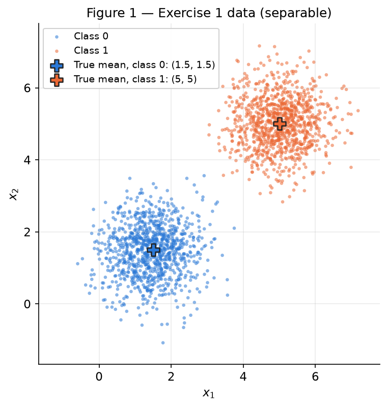
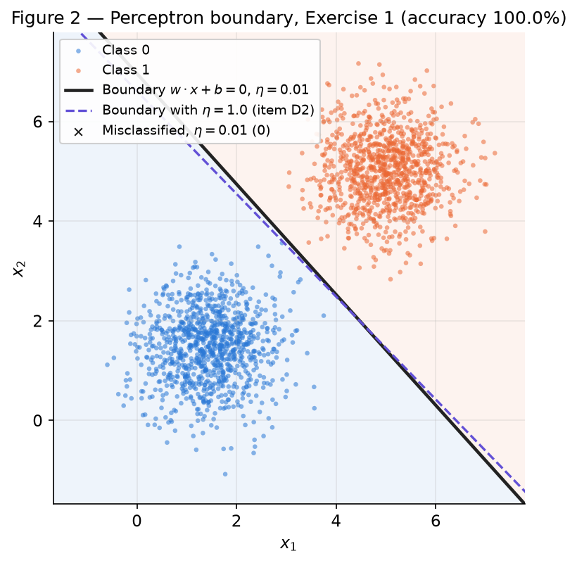
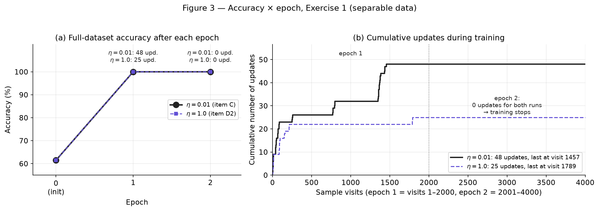
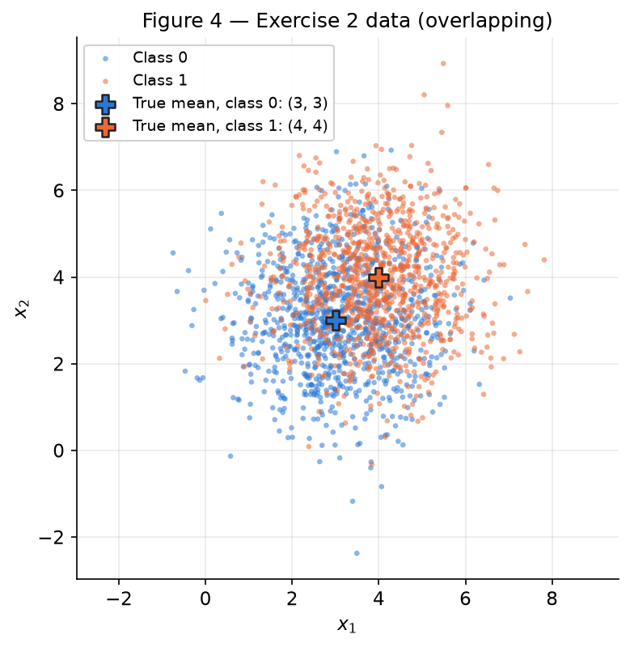
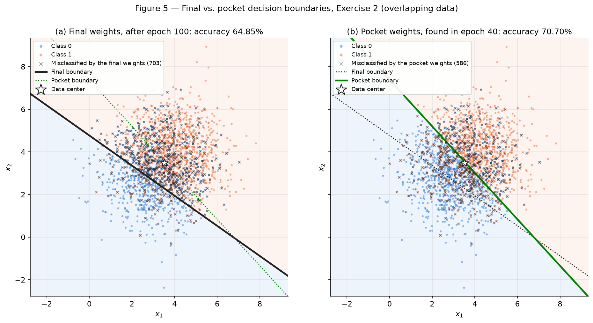
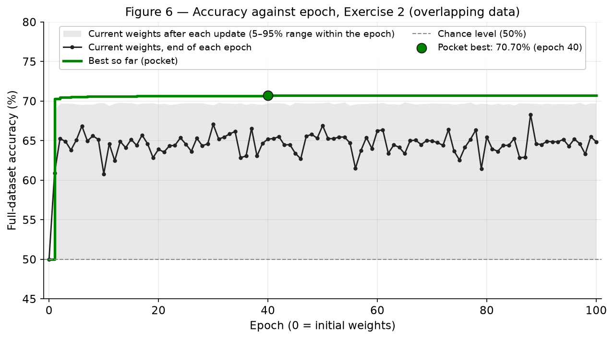

# 2. Perceptron

This report trains one hand-written perceptron on two datasets. The first is linearly separable
(Exercise 1), the second has heavily overlapping classes (Exercise 2). The aim is to show *why* the
algorithm converges on the first and *how* it fails on the second. Statement:
[Exercises → 2. Perceptron (2026.2)](https://insper.github.io/ann-dl/2026.2/exercises/perceptron/){:target='_blank'}.

**Re-running.** From the repository root, run `python docs/exercises/perceptron/code/main.py`. It
takes about 25 s on a laptop CPU. The script prints every number quoted below, one labelled line
each (`[Ex1 C] final w = …`), and rewrites `figures/fig1.png` … `fig6.png`. Two runs give identical
output.

**Seed policy.** `main.py` creates the report's single generator, `rng = np.random.default_rng(42)`,
once. It passes that generator to Exercise 1 and then to Exercise 2, in statement order. The only
random draws are the two datasets (2 × 1000 points plus one shuffle each) and the two initial weight
vectors `w0`. No other module creates randomness.

``` { .python .copy linenums="1" title="main.py — the single entry point" }
--8<-- "docs/exercises/perceptron/code/main.py:main"
```

!!! note "Implementation approach and challenges"

    **Approach.** The model is the `Perceptron` class in `code/perceptron.py`. It uses only NumPy
    and contains the step activation, prediction, the error-driven update and the training loop. It
    is written once and used unchanged by both exercises. `train()` accepts an optional hook,
    `on_update(model, epoch, i, error)`, called right after every actual update. Exercise 2 plugs
    the pocket algorithm into that hook (a `Pocket` object), so not one line of the class changes
    between exercises. A second hook, `Tracer`, only records `(epoch, sample, error, w, b)`. I use
    it for the update counts and boundary positions in the analyses. No scikit-learn appears
    anywhere, neither as a model nor as a utility.

    **Challenges and decisions.**

    1. *Pocket without editing the class.* The statement requires the Exercise 1 implementation to be
       reused unchanged. The hook solves this: the pocket copy lives outside the class.
    2. *Making "changing nothing else" exact.* `w0` is drawn **once** in Exercise 1 and passed to
       both the $\eta=0.01$ and the $\eta=1.0$ runs. Both runs therefore share data, sample order,
       `w0` and `b0 = 0`.
    3. *Sample order.* The generator produces all class-0 points and then all class-1 points. The
       data are shuffled once with `rng` right after generation, and every epoch visits the samples
       in that fixed order. This choice turned out to matter a lot in Exercise 2 (see 2-D1).
    4. *A one-epoch convergence leaves Figure 3 almost empty.* Exercise 1 converges inside epoch 1,
       so the accuracy curve has only three points. Figure 3 therefore has a second panel with the
       cumulative number of updates, which is the quantity item D1 asks about.
    5. *My numbers differ from the statement's reference values (≈50 % final, ≈73 % best line).*
       Before accepting them, I checked them against a fine scan of straight lines (a NumPy-only
       diagnostic, no training). On this sample no line beats **70.80 %**, so the pocket
       result (70.70 %) is optimal to within 2 samples out of 2000, not a bug. The final-weights gap
       is explained in 2-D1.

??? example "Full source of `main.py` (data generation, training runs, diagnostics, figures)"

    ``` { .python linenums="1" }
    --8<-- "docs/exercises/perceptron/code/main.py"
    ```

## Exercise 1

**Approach.** I draw 2 × 1000 points from the two Gaussians given in the statement and shuffle them
once. Then I train the from-scratch perceptron with $\eta=0.01$, $b_0=0$ and
$w_0\sim\mathcal N(0,0.01^2 I)$ until a full pass makes no update. Every update is logged, which
gives the per-epoch counts used in D1. Item D re-runs the identical setup with $\eta=1.0$ and from
$w=0,\ b=0$, and backs the algebraic argument of D3 with an exact numerical check.

### A — Generate the data

Class 0 is drawn from $\mathcal N\big([1.5, 1.5],\ 0.5\,I\big)$ and class 1 from
$\mathcal N\big([5, 5],\ 0.5\,I\big)$, 1000 samples each, with `rng.multivariate_normal`. The means
are $\lVert\mu_1-\mu_0\rVert = 4.95$ apart and $\sigma=\sqrt{0.5}=0.71$ per axis. Projected on the
diagonal, each class mean sits $3.5\sigma$ from the midpoint, so the clouds are separated by a wide
empty band.

``` { .python .copy linenums="1" title="main.py — data generator (shared by both exercises)" }
--8<-- "docs/exercises/perceptron/code/main.py:data"
```

``` { .python .copy linenums="1" title="main.py — Exercise 1 parameters" }
--8<-- "docs/exercises/perceptron/code/main.py:ex1-data"
```

The sample statistics match the specification. Class 0 has mean $[1.450, 1.473]$ and covariance
$\begin{bmatrix}0.491&0.029\\0.029&0.513\end{bmatrix}$. Class 1 has mean $[5.010, 5.013]$ and
covariance $\begin{bmatrix}0.495&0.010\\0.010&0.499\end{bmatrix}$. The average point norm is
$\overline{\lVert x\rVert}=4.65$.


/// caption
**Figure 1** — The 2000 Exercise 1 points, one color per class, with the true means marked (+). The
two clouds are separated by an empty band.
///

### B — Implement the perceptron

The model predicts $\hat y=\operatorname{step}(w\cdot x+b)$, with $\operatorname{step}(z)=1$ if
$z\ge 0$ and $0$ otherwise. Labels are $y\in\{0,1\}$. For each sample, in the fixed shuffled order,
it computes $\hat y$ and applies

$$
w \leftarrow w + \eta\,(y-\hat y)\,x, \qquad b \leftarrow b + \eta\,(y-\hat y).
$$

The error $e=y-\hat y$ is $0$ on a correct prediction, so nothing changes. It is $+1$ on a missed
class-1 point, which pulls $w$ towards $x$, and $-1$ on a false class-1, which pushes $w$ away from
$x$. That is why the rule is written with $(y-\hat y)$ and not with the $\pm1$-label form $\eta y x$.

* **Initialization.** The caller draws `w0 = rng.normal(0, 0.01, size=2)` from the report's `rng`
  (see item C) and passes it to `train()` with `b0 = 0`. The class itself never creates randomness.
* **Learning rate.** $\eta = 0.01$.
* **Stopping.** Training ends after the first epoch with zero updates, or after `max_epochs = 100`.
* **Bookkeeping.** After every epoch the loop records the full-dataset accuracy and the number of
  updates (`history`).
* **Prediction function.** Training calls `self.predict(x_i)`, the same function used at
  inference, so the training rule and the evaluated model can never disagree.

``` { .python .copy linenums="1" title="perceptron.py — the whole model (reused unchanged in Exercise 2)" }
--8<-- "docs/exercises/perceptron/code/perceptron.py"
```

### C — Train and measure

The training call draws `w0` once and attaches a recording hook. The hook does not affect the
trajectory; it only logs which sample triggered each update.

``` { .python .copy linenums="1" title="main.py — Exercise 1 training run (η = 0.01)" }
--8<-- "docs/exercises/perceptron/code/main.py:ex1-train"
```

``` { .python .copy linenums="1" title="main.py — Tracer hook (records, never modifies)" }
--8<-- "docs/exercises/perceptron/code/main.py:tracer"
```

**1. Results.**

* The initial weights are $w_0=[0.009914,\,-0.008270]$ ($\lVert w_0\rVert=0.0129$) with $b_0=0$.
  They classify 61.50 % of the points correctly.
* **Final weights: $w=[0.0319,\ 0.0287]$, final bias: $b=-0.2000$.**
* **Epochs: 2.** All 48 updates happen in epoch 1. Epoch 2 is a full pass with zero updates, which
  triggers the stopping rule.
* **Final accuracy: 100.00 %.** All 2000 points are correctly classified, 0 misclassified. The
  accuracy recorded after epochs 1 and 2 is 100.00 % both times.
* The learned line $0.0319\,x_1+0.0287\,x_2-0.2=0$ crosses the diagonal $x_1=x_2$ at
  $(3.30,\,3.30)$. It passes 4.66 units from the origin, and its closest point is 0.112 away.

**2. Decision boundary.**


/// caption
**Figure 2** — The learned boundary $w\cdot x+b=0$ ($\eta=0.01$, solid black) over the data, with
the predicted half-planes tinted. Misclassified points would be marked ×; there are none. The dashed
violet line is the $\eta=1.0$ boundary from item D2.
///

**3. Accuracy × epoch.**


/// caption
**Figure 3** — (a) Full-dataset accuracy after each epoch: 61.50 % at initialization, 100 % after
epoch 1, 100 % after epoch 2. The $\eta=1.0$ curve (dashed) coincides with it. (b) Cumulative updates
against sample visits. All updates fall in epoch 1, and the curves are flat throughout epoch 2.
///

### D — Analysis

#### D1 — Why separable data converges quickly

The update term $\eta\,(y-\hat y)$ is zero for every correctly classified sample. The number of
updates in an epoch is therefore exactly the number of mistakes the moving line makes during that
pass. Training stops as soon as that number reaches 0.

* **Updates per epoch: 48 in epoch 1, then 0 in epoch 2.** Epoch 2 makes no update, so training
  stops after 2 epochs.
* **Inside epoch 1, updates are dense only at the very start (Figure 3b).** Visits 1–100 trigger 23
  updates, one every 4 samples. The remaining 1900 visits trigger only 25, one every 76 samples:
  3 in visits 101–500, 6 in 501–1000 and 16 in 1001–2000. The last update happens at visit 1457.
  The remaining 543 visits of epoch 1 and all 2000 visits of epoch 2 change nothing.
* **The line reaches the gap almost immediately.** After only 9 updates (visit 13) the accuracy is
  already 96.40 %. From then on, the only points that can still trigger an update are the few the
  current line gets wrong, near the gap. They arrive rarely, so updates come in 5 short bursts
  (visits 1–88, 250–258, 772–797, 1351–1387 and 1435–1457) separated by hundreds of correct, silent
  samples. Inside a burst the corrections tend to overshoot, because one step of size $\eta x$ is
  large next to $\lVert w\rVert\approx0.04$. Accuracy dips to 50.0 % inside three of the bursts.
  The bursts hold 3 to 23 updates, and each one ends with the accuracy back at 96.2–100 %. The same
  overshoot mechanism dominates Exercise 2.
* **Once the line lies inside the empty band, $y-\hat y=0$ for every sample.** The weights then
  freeze, however many passes follow. That is what epoch 2 shows.

The convergence theorem makes this precise. With a separating margin $\gamma>0$ and data radius $R$,
the number of updates is at most $(R/\gamma)^2$. For these data, the widest-margin line found by the
scan has a geometric margin of 0.2348. In the augmented space $(x,1)$ that gives $\gamma=0.0506$
with $R=9.17$, so the bound is about 32 898 updates. The bound is loose but finite. The observed
counts are far below it: 48 updates, or 25 from a zero start (D3). That is because almost every
point lies far from any line drawn through the gap: the means are $7\sigma$ apart.

#### D2 — Re-running with η = 1.0

Same data, same sample order, same $w_0=[0.009914,\,-0.008270]$, same $b_0=0$; only $\eta$ changes.

``` { .python .copy linenums="1" title="main.py — η = 1.0 re-run and direction comparison" }
--8<-- "docs/exercises/perceptron/code/main.py:ex1-eta"
```

| | $\eta = 0.01$ (item C) | $\eta = 1.0$ |
| --- | --- | --- |
| Epochs run | 2 | **2** |
| Updates in epoch 1 / epoch 2 | 48 / 0 | 25 / 0 |
| Final accuracy | 100.00 % | **100.00 %** |
| Final $w$, $b$ | $[0.0319,\ 0.0287]$, $-0.2000$ | $[1.7173,\ 1.6646]$, $-11.0000$ |
| $\lVert w\rVert$ | 0.0429 | 2.3917 |
| Direction $w/\lVert w\rVert$ | $[0.7429,\ 0.6694]$ | $[0.7181,\ 0.6960]$ |
| Distance origin → line, $-b/\lVert w\rVert$ | 4.6590 | 4.5993 |
| Crossing of the diagonal $x_1=x_2$ | $(3.2989,\ 3.2989)$ | $(3.2526,\ 3.2526)$ |
| Effective initialization $\lVert w_0\rVert/\eta$ | 1.2911 | 0.0129 |

Both runs reach **100.00 % in 2 epochs**, but with different boundaries. The unit normals differ by
**2.09°**, and the lines cross the diagonal at 3.30 versus 3.25 (Figure 2, solid versus dashed).

**What $\eta$ controls.** Every update adds $\pm\eta x$ to $w$ and $\pm\eta$ to $b$, and $b_0=0$.
After $k$ updates with errors $e_j=\pm1$ on samples $x_{(j)}$:

$$
w_k = w_0 + \eta\sum_{j=1}^{k} e_j\,x_{(j)}, \qquad b_k = \eta\sum_{j=1}^{k} e_j
\quad\Longrightarrow\quad
\frac{w_k}{\eta} = \frac{w_0}{\eta} + \sum_{j=1}^{k} e_j\,x_{(j)}, \qquad \frac{b_k}{\eta}=\sum_{j=1}^{k} e_j .
$$

Multiplying $(w,b)$ by a positive constant changes neither the predictions nor the boundary, so the
run behaves exactly like a unit-step perceptron started from $w_0/\eta$. **$\eta$ acts only through
the ratio $w_0/\eta$, i.e. how much the random initialization weighs against the data.** That ratio
changes which predictions go wrong early, so it changes the path, the number of updates (48 versus
25) and the separating line where training stops. It did not change the epoch count or the final
accuracy here (2 epochs and 100 % in both runs).

* With $\eta=0.01$, $\lVert w_0\rVert/\eta = 1.29$, more than a quarter of a typical point
  ($\overline{\lVert x\rVert}=4.65$). Equivalently, each update adds only $\eta\lVert x\rVert\approx
  0.047$, about $3.6\lVert w_0\rVert$. The random start therefore tips early predictions, and it is
  still about 30 % of the final norm ($0.0129$ of $0.0429$). The run follows its own path, with 48
  updates instead of 25.
* With $\eta=1$, $\lVert w_0\rVert/\eta=0.013$, so the first update (size $\approx4.65$, about 360 times
  $\lVert w_0\rVert$) wipes the start out. The $\eta=1.0$ run makes *exactly* the same 25 updates
  (same samples, same signs) as a zero start, and its final weights differ from the zero-start weights
  by exactly $w_0=[0.009914,\,-0.008270]$ (verified in the code).

Because the data leave a wide band of separating lines, the perceptron stops at the first line it
reaches. $\eta$, through $w_0/\eta$, decides which line that is. The bias makes the scaling visible.
It only moves in multiples of $\eta$: $b=-0.20=-20\eta$, meaning 20 more false-positive than
false-negative corrections, versus $b=-11=-11\eta$.

#### D3 — What would have happened from w = 0, b = 0

**Claim.** Run the whole training twice from $w=0,\ b=0$, with the same data and order and with
learning rates $\eta_1$ and $\eta_2$. Let $c=\eta_2/\eta_1>0$. Then after every sample visit $t$
(each visit either updates or not, so the claim covers every update):

$$
w^{(2)}_t = c\,w^{(1)}_t, \qquad b^{(2)}_t = c\,b^{(1)}_t .
$$

**Proof by induction on $t$.**

*Base case ($t=0$).* $w^{(2)}_0 = 0 = c\cdot 0 = c\,w^{(1)}_0$, and likewise for $b$.

*Inductive step.* Assume the claim holds at $t$. Visit $t+1$ shows both runs the same sample
$(x, y)$, because the order is fixed. The two pre-activations are proportional:

$$
z^{(2)} = w^{(2)}_t\cdot x + b^{(2)}_t = c\,\big(w^{(1)}_t\cdot x + b^{(1)}_t\big) = c\,z^{(1)} .
$$

Since $c>0$, $z^{(2)}\ge 0 \iff z^{(1)}\ge 0$, including the tie $z=0$, because $c\cdot0=0$. So
$\hat y^{(2)}=\hat y^{(1)}$, and both runs see the same error $e=y-\hat y$. Then

$$
\begin{aligned}
w^{(2)}_{t+1} &= w^{(2)}_t + \eta_2\,e\,x = c\,w^{(1)}_t + c\,\eta_1\,e\,x = c\,\big(w^{(1)}_t + \eta_1\,e\,x\big) = c\,w^{(1)}_{t+1},\\
b^{(2)}_{t+1} &= b^{(2)}_t + \eta_2\,e = c\,b^{(1)}_t + c\,\eta_1\,e = c\,b^{(1)}_{t+1}.
\end{aligned}
$$

So the claim holds at $t+1$. $\blacksquare$

**Consequences.**

1. The inductive step showed that both runs make the *same prediction and the same error at every
   visit*. They update on exactly the same samples, so every epoch has the same number of updates.
   The stopping rule ("an epoch with 0 updates") fires in the same epoch: **the epoch count is
   identical.**
2. The final parameters satisfy $(w^{(2)},b^{(2)})=c\,(w^{(1)},b^{(1)})$ with $c>0$. The set
   $\{x: w\cdot x+b=0\}$ and the sign of $w\cdot x+b$ are unchanged by a positive factor, so **the
   decision boundary, every prediction and the whole accuracy curve are identical.** $\eta$ only
   rescales $w$ and has no effect at all.
3. With the closed form from D2 and $w_0=0$: $w=\eta\sum e_j x_{(j)}$ and $b=\eta\sum e_j$. The
   factor $\eta$ multiplies a sum that does not depend on $\eta$.

**Why item B forbids the zero start.** With $w_0\neq0$ the base case fails ($w_0\neq c\,w_0$ for
$c\neq1$). The effective start $w_0/\eta$ then depends on $\eta$, and that is precisely what made
the two runs in D2 differ.

**Numerical check (not a substitute for the proof).**

``` { .python .copy linenums="1" title="main.py — zero-start check" }
--8<-- "docs/exercises/perceptron/code/main.py:ex1-zero"
```

* $\eta=0.01$: $w=[0.017074,\ 0.016729]$, $b=-0.110000$, 2 epochs, updates per epoch $[25, 0]$.
* $\eta=1.0$: $w=[1.707430,\ 1.672855]$, $b=-11.000000$, 2 epochs, updates per epoch $[25, 0]$.
* The ratios $w^{(2)}/w^{(1)}$ and $b^{(2)}/b^{(1)}$ are $100.0000000000$ for both weights and the
  bias, which is exactly $\eta_2/\eta_1$. The two update sequences (epoch, sample, sign) are
  identical.

## Exercise 2

**Approach.** I generate the overlapping dataset with the same generator and the same `rng`. I then
train with the *identical* `Perceptron` class, call and settings ($\eta=0.01$, 100-epoch cap, `w0`
drawn from `rng`, $b_0=0$), adding only a `Pocket` hook that copies $(w,b)$ whenever an update
reaches a new best full-dataset accuracy. For the analysis, a deterministic replay with the
recording hook logs the boundary after each of the 76 620 updates. Two confirmation runs (1000
epochs; $\eta=0.001$) back, but do not replace, the argument in D3.

### A — Generate the data

Class 0 is drawn from $\mathcal N\big([3, 3],\ 1.5\,I\big)$ and class 1 from
$\mathcal N\big([4, 4],\ 1.5\,I\big)$, 1000 samples each, with the same `make_two_gaussians` function
(shown in Exercise 1-A). The means are only $\sqrt2=1.41$ apart while $\sigma=\sqrt{1.5}=1.22$, a
separation of $1.15\sigma$. Even the best possible line, the perpendicular bisector, has a
population accuracy of only $\Phi\big(\tfrac{\sqrt2}{2\sqrt{1.5}}\big)=\Phi(0.577)\approx 71.8\,\%$.

``` { .python .copy linenums="1" title="main.py — Exercise 2 parameters" }
--8<-- "docs/exercises/perceptron/code/main.py:ex2-data"
```

The sample statistics match the specification. Class 0 has mean $[3.072, 3.019]$ and covariance
$\begin{bmatrix}1.472&0.015\\0.015&1.607\end{bmatrix}$. Class 1 has mean $[3.955, 3.955]$ and
covariance $\begin{bmatrix}1.454&-0.006\\-0.006&1.582\end{bmatrix}$. The average point norm is
$\overline{\lVert x\rVert}=5.11$, and the data center is $c=[3.513,\ 3.487]$ with
$\lVert c\rVert=4.95$.


/// caption
**Figure 4** — The 2000 Exercise 2 points, one color per class, with the true means marked (+). The
clouds overlap heavily and no straight line separates them.
///

### B — Train, keeping the best weights

The pocket is a callable object passed as `on_update`. After each update it evaluates the current
weights on all 2000 points (one vectorized product) and copies $(w,b)$ if the accuracy beats
everything seen so far. The starting weights count as "seen". The copy is the only addition to the
loop; `perceptron.py` is byte-for-byte the file shown in Exercise 1-B.

``` { .python .copy linenums="1" title="main.py — pocket hook" }
--8<-- "docs/exercises/perceptron/code/main.py:pocket"
```

``` { .python .copy linenums="1" title="main.py — Exercise 2 training run (same class, same settings)" }
--8<-- "docs/exercises/perceptron/code/main.py:ex2-train"
```

**Results.** The initial weights are $w_0=[-0.014556,\,-0.004621]$ with $b_0=0$, at 50.00 %
accuracy. Training runs the full **100 epochs**. The stopping rule never fires: every epoch makes
between 739 and 822 updates (mean 766.2, 76 620 in total).

| Weights | $w$ | $b$ | Accuracy (2000 points) |
| --- | --- | --- | --- |
| **Final** (after epoch 100) | $[0.0682,\ 0.0965]$ | $-0.4600$ | **64.85 %** |
| **Pocket** (best so far) | $[0.0709,\ 0.0650]$ | $-0.4800$ | **70.70 %** |

The pocket was refilled 15 times. Its best was found in **epoch 40**, at update 30 008 of 76 620.
After epoch 1 it already held 70.30 %, and after epoch 10 it held 70.60 %.

**Comparison with the statement's reference values.** The statement anticipates about 73 % for the
best line and about 50 % for the final weights. I report what I measured:

* **Pocket.** A fine scan over 7200 directions (0.05° steps), each with its best threshold (a NumPy
  diagnostic, no training), finds that **no straight line exceeds 70.80 % on this sample**: 584
  points stay misclassified. The pocket is therefore 0.10 points (2 samples) below the best possible
  line, consistent with the population optimum of 71.8 %. The 73 % in the statement belongs to a
  different sample.
* **Final weights.** They score 64.85 %, not ≈50 %. D1 shows that the final accuracy is a random
  snapshot of an oscillating boundary, and that it drops to 50.25 % when samples are visited class by
  class.

### C — Figures

**1. Both decision boundaries.**


/// caption
**Figure 5** — (a) The final boundary (black, 64.85 %, 703 points misclassified ×) lies on the
class-0 side of the data center (☆) and labels 75.8 % of the points as class 1. (b) The pocket boundary
(green, 70.70 %, 586 misclassified ×) passes through the center, almost perpendicular to the
diagonal. Each panel tints its own predicted half-planes and also shows the other boundary dotted.
///

**2. Accuracy curves.**


/// caption
**Figure 6** — Accuracy of the current weights at the end of each epoch (black), and of the
best-so-far pocket weights (green staircase). The pocket best is 70.70 % (epoch 40). The grey band is
the 5–95 % range of the current weights' accuracy after the individual updates inside each epoch. It
spans roughly 50–70 % in every epoch.
///

??? example "Plotting helpers used for Figures 1, 2, 4 and 5 (`main.py`)"

    ``` { .python linenums="1" }
    --8<-- "docs/exercises/perceptron/code/main.py:plot-helpers"
    ```

### D — Analysis

#### D1 — The gap between the final and the pocket weights

**Where the two boundaries sit (Figure 5).**

* **Pocket boundary.** It crosses the diagonal at $(3.53,\,3.53)$, 0.04 units from the data center.
  It predicts class 1 for 47.8 % of the points, with balanced recalls (class 0: 72.9 %, class 1:
  68.5 %).
* **Final boundary.** It crosses the diagonal at $(2.79,\,2.79)$, which is **0.98 units (0.70 of the
  cloud's standard deviation of 1.395 along the diagonal) to the class-0 side of the center**, even
  beyond the class-0 mean $(3,3)$. It is also tilted 9.7° off the diagonal direction. It labels
  75.8 % of all points as class 1. Class-1 recall is 90.6 %, but class-0 recall is only 39.1 %:
  most of the blue cloud is on the wrong side.

**Why the loop leaves it there: one mistake moves the line by more than a cloud width.** The hint
compares the two halves of an update:

$$
\lvert\Delta b\rvert = \eta = 0.01, \qquad \lVert\Delta w\rVert = \eta\,\lVert x\rVert \approx 0.01\times5.11 = 0.051 .
$$

The data sit about 5 units from the origin. The line's distance from the origin is
$\lvert b\rvert/\lVert w\rVert$, so its position is controlled by the ratio of $b$ to
$\lVert w\rVert$. That ratio is badly unbalanced:

* **$b$ barely moves.** During epoch 100, $b$ stayed in $[-0.48,\,-0.40]$, a net drift of 8 steps.
  Over the whole run there were 38 287 false-negative corrections ($b\mathrel{+}=\eta$) and 38 333
  false-positive corrections ($b\mathrel{-}=\eta$), which almost cancel.
* **$\lVert w\rVert$ swings wildly.** Over the same epoch it ranged over $[0.0083,\,0.1820]$, because
  each step of size $0.051$ is comparable to $\lVert w\rVert$ itself.
* **So the line passes through the center only near one value of $\lVert w\rVert$.** With
  $b\approx-0.46$, that value is $\lVert w\rVert\approx0.46/4.95=0.093$, and a single update
  changes $w$ by about $0.051$, more than half of it. The line is thrown back and forth: during
  epoch 100 its distance from the origin, $-b/\lVert w\rVert$, ranged from 3.00 to 12.15 units
  (5th–95th percentile), while the data center sits 4.95 units from the origin.
* **The same effect, seen from the data.** One update changes the score of the center by
  $\eta\,(x\cdot c+1)\approx0.255$ on average, because $x\cdot c\approx25$ dwarfs the $+1$ that
  comes from $b$. The score only varies by $\lVert w\rVert\approx0.095$ per unit of distance, so one
  mistake shifts the boundary by about $0.255/0.095\approx2.7$ units along its normal.
* **Measured.** In epoch 100 the median jump of the center's signed distance to the line was
  **2.71 units per update**, about **1.9 cloud standard deviations**. The 5–95 % range of that
  distance was $[-8.90,\ +1.81]$. In one epoch, the line goes from far beyond the class-1 cloud,
  where it labels almost everything 0, to the class-0 side and back.

Since the classes overlap, every position of the line leaves misclassified points on both sides.
Mistakes keep arriving from both classes, ≈383 from each (382.9 on class-1 points and 383.3 on
class-0 points per epoch on average, ≈766 updates per epoch in total), and each one kicks the
line roughly two standard deviations. **The "final" weights are simply wherever the last kick of
epoch 100 left the line.** In this run, that was the class-0 side.

**The final accuracy is a lottery; the pocket is the best ticket.** Across all 76 620 states the
weights visit, the accuracy has a median of 60.8 %, a 5th percentile of 50.0 % and a 95th percentile
of 69.7 %. A quarter of the states (24.7 %) are below 55 %, and only 2.3 % reach 70 %. The
end-of-epoch snapshots in Figure 6 range from 60.80 % (epoch 10) to 68.30 % (epoch 88), with a mean
of 64.60 %. Our 64.85 % is a typical draw. The pocket scores every visited state and keeps the
maximum, 70.70 %; the code asserts that it equals the best of the 76 620 states. The 5.85-point gap
is therefore the gap between the best visited state and a typical end-of-epoch state (mean
64.60 % at the epoch ends; median 60.8 % over all visited states).

**Sample order decides the draw, not the outcome.** As a side run, I re-sort the same shuffled samples
by class: all class 0 first, then all class 1, keeping the shuffled order within each class. This
reproduces the class-block structure of the raw generation order. Now the last 1000 visits of every
epoch are class-1 points, so every update there is an $e=+1$ correction. Each of those corrections
adds $\approx\eta\lVert x\rVert\approx0.05$ to $w$, along the direction of the cloud, but only
$\eta=0.01$ to $b$. This is the statement's hint. The class-1 scores $w\cdot x+b$ therefore rise
much faster through $w$ than the bias can offset, and the line is dragged towards the origin.

* The final weights are $w=[0.0457,\ 0.0374]$ with only $b=-0.0600$. The line crosses the diagonal
  at $(0.72,\,0.72)$, 1.02 units from the origin.
* That is 3.91 units from the data center, about 2.8 cloud standard deviations, on the class-0
  side: **completely outside the cloud**.
* The final weights label 99.8 % of the points as class 1 and score **50.25 %**. That is the
  "near 50 %" scenario the statement warns about.

Shuffling, as done here, makes the snapshot random instead of systematically bad. It does not stop
the oscillation.

#### D2 — Figure 3 vs. Figure 6: what the convergence theorem guarantees

* **Figure 3 (separable).** Accuracy jumps from 61.50 % to 100 % within epoch 1 and stays there.
  Updates per epoch fall from 48 to 0, and training stops by itself after epoch 2.
* **Figure 6 (overlapping).** The current weights never settle. End-of-epoch accuracy wanders between
  60.80 % and 68.30 %, and inside every epoch the accuracy after individual updates spans about
  50–70 % (grey band). Epoch 100 still makes 757 updates, and the stopping rule never fires. The
  only flat curve is the green pocket staircase, flat after epoch 40. It is monotone by
  construction (a running maximum), not because training converged.

**The perceptron convergence theorem (Novikoff).** Write labels as $s_i=2y_i-1\in\{-1,+1\}$ and
use augmented points $\tilde x_i=(x_i,1)$ with $\lVert\tilde x_i\rVert\le R$. Suppose some unit
vector $u^{\star}$ separates the data with a **positive margin**,
$s_i\,u^{\star}\cdot\tilde x_i\ge\gamma>0$ for all $i$. Then, from a zero start, the perceptron makes at
most $(R/\gamma)^2$ updates, for any sample order and any $\eta$. After that it classifies every
point correctly and stops.

*Why.* Each update raises $u^{\star}\cdot\tilde w$ by at least $\eta\gamma$ and raises
$\lVert\tilde w\rVert^2$ by at most $\eta^2R^2$. So $k\eta\gamma\le\lVert\tilde w_k\rVert\le\eta
R\sqrt k$, which gives $k\le(R/\gamma)^2$.

* **Exercise 1.** $\gamma=0.0506$ and $R=9.17$, so the bound is about 32 898 updates: finite, and
  satisfied with room to spare (48 updates).
* **Exercise 2.** The assumption that breaks is **linear separability, i.e. the existence of a
  margin $\gamma>0$.** The best line still misclassifies 584 points (70.80 %). The scan finds the
  two classes' projections overlapping in every direction: the widest "margin" is $-3.16<0$. No
  $\gamma>0$ exists, so the bound is infinite and the theorem guarantees nothing. It guarantees
  neither convergence nor a good last iterate.
* **What does hold here.** The companion result for non-separable data, the perceptron cycling
  theorem (Minsky & Papert; Block & Levin), says only that the weights stay bounded. That is what we
  see: $\lVert w\rVert$ never exceeds 0.1875, and its mean is 0.0945 in epochs 1–50 versus 0.0953
  in epochs 51–100. The weights wander in a bounded region forever instead of converging.

#### D3 — Would more epochs, or a smaller η, fix it?

**No, and the update rule shows why.**

**More epochs.**

* The loop stops only after a pass in which every $y-\hat y=0$. That pass would require a line that
  classifies all 2000 points correctly, and none exists. Every epoch, forever, contains mistakes
  (739–822 per epoch in this run), and every mistake moves the line.
* The step does not shrink with time. The jump per mistake is
  $\approx\eta(x\cdot c+1)/\lVert w\rVert$, and $\lVert w\rVert$ does not grow: it stays bounded
  around 0.095, as D2 showed. Nothing in the rule decays, accumulates or averages.
* So epoch 1000 is statistically the same as epoch 100: the last iterate is still a random point
  of the same bounded oscillation. More epochs only buy more lottery tickets, which helps the pocket
  a little and the final weights not at all.

**A smaller $\eta$.**

* The rule is homogeneous in $\eta$: every update adds $\eta$ times $(e\,x,\ e)$. Once the
  accumulated updates outweigh $w_0$, $(w,b)/\eta$ follows the same $\eta$-independent trajectory.
  This is the zero-start argument of Exercise 1-D3, applied after the brief transient in which
  $w_0/\eta$ still matters.
* $\lVert\Delta w\rVert$, $\lvert\Delta b\rvert$ and $\lVert w\rVert$ all scale by $\eta$. The
  geometric jump of the line, $\eta(x\cdot c+1)/\lVert w\rVert$, is unchanged, and so is the
  5 : 1 ratio between $\lVert\Delta w\rVert$ and $\lvert\Delta b\rvert$. That ratio comes from
  $\lVert x\rVert\approx5$, a property of the data, not of $\eta$.
* A smaller $\eta$ therefore rescales the weights without making the steps any finer relative to
  the cloud. The only other effect is to make the random $w_0$ matter for longer.

What does help is changing what we *keep*: the pocket, or, for example, averaging the iterates.
Changing the *rule or loss* would also help. Neither more time nor a smaller step does.

**Confirmation runs (consistent with the argument, not a replacement for it).**

* *1000 epochs, $\eta=0.01$.* The final accuracy is 65.05 %. Epochs 901–1000 average 64.80 %
  (range 54.55–66.90 %), and epoch 1000 still makes 759 updates.
* *$\eta=0.001$, 100 epochs.* The final accuracy is 68.25 %. Epochs 51–100 average 64.65 % (range
  62.80–68.25 %), and epoch 100 makes 776 updates.

Both runs land in the same band as the original run (end-of-epoch mean 64.60 %). Neither settles.

## Results summary

| # | Quantity | Value |
| --- | --- | --- |
| 1 | Exercise 1 — final w and b | $w=[0.0319,\ 0.0287]$, $b=-0.2000$ |
| 2 | Exercise 1 — epochs to convergence | 2 (all 48 updates in epoch 1; epoch 2 is the update-free pass that stops training) |
| 3 | Exercise 1 — final accuracy | 100.00 % (0 of 2000 points misclassified) |
| 4 | Exercise 1 — epochs and final accuracy with $\eta=1.0$ | 2 epochs (25 updates, all in epoch 1); 100.00 % |
| 5 | Exercise 2 — final w and b | $w=[0.0682,\ 0.0965]$, $b=-0.4600$ |
| 6 | Exercise 2 — accuracy of the final weights | 64.85 % |
| 7 | Exercise 2 — accuracy of the pocket weights | 70.70 % ($w=[0.0709,\ 0.0650]$, $b=-0.4800$) |
| 8 | Exercise 2 — epoch at which the pocket best occurred | Epoch 40 (update 30 008 of 76 620) |
