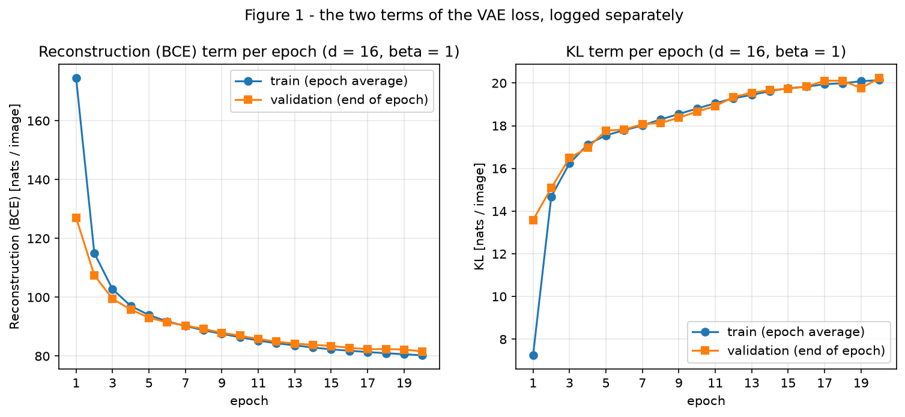
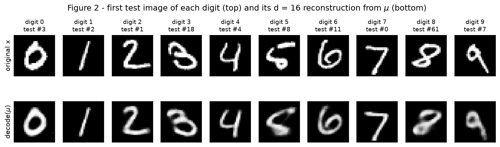
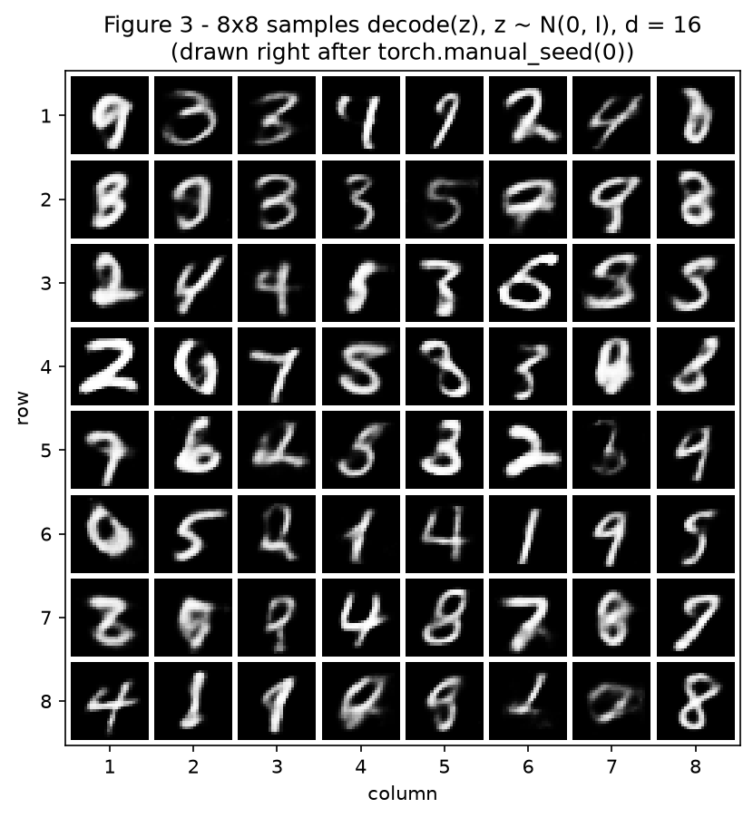
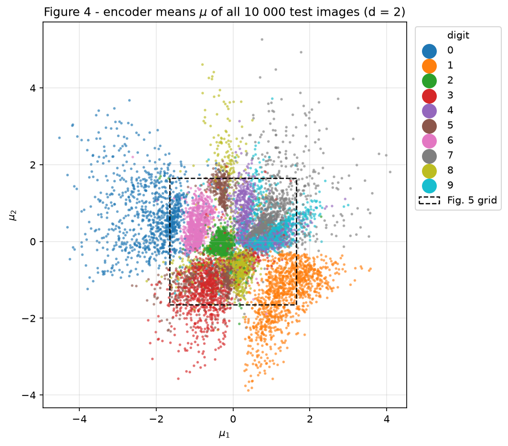
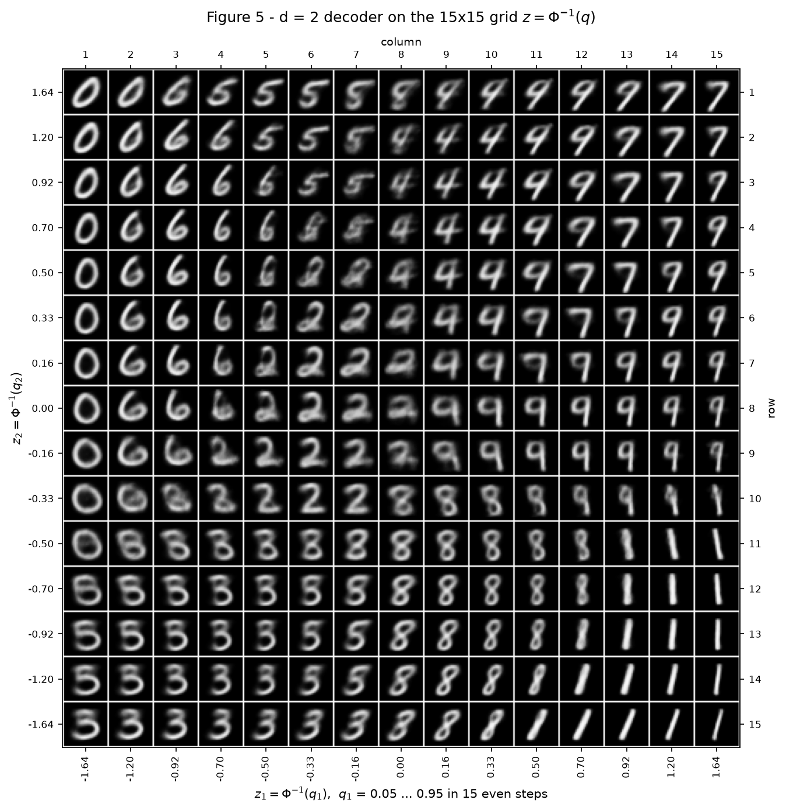
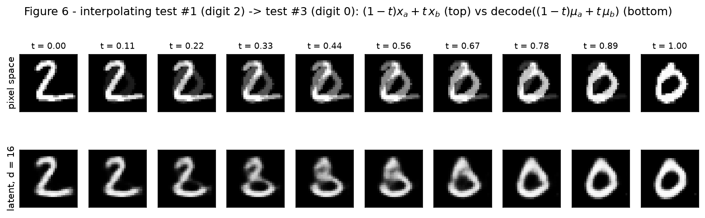

# 4. VAE

This report trains a variational autoencoder (VAE) on MNIST and follows the statement's thread,
the tug of war inside the loss. A VAE pays for two things at once: reconstructing its input, and
keeping each code distribution $q(z\mid x)$ close to the prior $\mathcal N(0, I)$. So every loss
below is reported as its two terms, separately, in **nats per image**: summed over the 784 pixels
(or the $d$ latent dimensions) and averaged over the images. Exercise 1 trains a VAE with a
16-dimensional latent space. Exercise 2 retrains the same model with $d = 2$, so the latent space
can be drawn, and measures what that costs.

!!! info "Statement, re-running and seeds"

    - **Statement:** [Exercises → 4. VAE (2026.2)](https://insper.github.io/ann-dl/2026.2/exercises/vae/){:target='_blank'}
    - **Re-run** from the repository root with `python docs/exercises/vae/code/main.py`. MNIST is
      downloaded to `./data/` (git-ignored). The script writes `figures/fig1.png` … `fig6.png` and
      prints every number quoted in this report, each with a label.
    - **Seeds:** `torch.manual_seed(42)` right before building each model (first $d=16$, then
      $d=2$), the split generator `torch.Generator().manual_seed(42)` from the statement, and
      `torch.manual_seed(0)` right before Figure 3's prior samples. Weight initialisation,
      mini-batch shuffling and every $\varepsilon$ of the reparameterization come from these
      seeds, so a re-run reproduces every number exactly. I ran the script four times on the same
      machine, and every training and test number came out identical. Another CPU or library
      version may change the last decimals.
    - **Run time:** about one minute of training per model on a CPU (8 threads, torch 2.15, Windows 11).
      In the final run that was 63.9 s for $d=16$ and 71.2 s for $d=2$, and 144 s for the whole script
      including data preparation, figures and diagnostics. Across four runs on a machine shared with
      other jobs, the per-model time ranged from 59 to 71 s.
    - **Code:** `code/vae.py` holds the model, the reparameterization, the two loss terms and the
      train/evaluate loops. `code/main.py` is the single entry point: data, both experiments,
      Figures 1–6 and the diagnostics used in the analyses.

Design decisions, stated once for the whole report:

1. **Single-sample estimates everywhere.** Validation and test numbers use the same pass as
   training: encode, draw **one** $z = \mu + \sigma\odot\varepsilon$ per image, decode. They are
   one-sample estimates of exactly the loss being optimised.
2. **Test set only at the end.** All hyperparameters are fixed by the statement, and nothing is
   tuned or early-stopped. Validation is the only thing watched during training. The test images
   are turned into a tensor only after the $d=16$ training ends. They are then used for the final
   numbers and for Figures 2, 4 and 6, which the statement defines on test images.
3. **One process, no checkpoints.** Both models are trained in the same run of `main.py`, so
   Figure 6 uses the $d=16$ model still in memory. No weights are written to disk or to git.
4. **Decoder outputs are shown as grey levels.** Figures 2, 3, 5 and 6 display the decoder's
   Bernoulli means $\hat x\in(0,1)^{784}$ directly. No pixels are sampled.

## Exercise 1

I wrote the VAE in PyTorch and let autograd compute the gradients. The reparameterization, both
loss terms and the prior sampling are written by hand in `vae.py` and `main.py`. The $d=16$ model
is built right after `torch.manual_seed(42)` and trained for 20 epochs with Adam (learning rate
$10^{-3}$, batch 128, $\beta = 1$). Reconstruction and KL are logged separately on train and
validation every epoch, and the test set is evaluated once, after training.

### A — Load and split the data

The split is the statement's code, verbatim: the 60 000 official training images are divided by
`random_split` into **50 000 for training and 10 000 for validation**, with the generator seeded
with 42. The 10 000 official test images are the test set. `transforms.ToTensor()` already maps the
pixels to $[0, 1]$. Each image is run through that transform once and flattened to a 784-vector,
and the run prints `train (50000, 784), val (10000, 784)` with pixel range $[0, 1]$. Caching the
tensors only saves time; the values are exactly what `ToTensor` returns.

``` { .python .copy linenums='1' title="main.py — data" }
--8<-- "docs/exercises/vae/code/main.py:data"
```

The start of `main()` shows the order: the train and validation tensors are built first, the
$d=16$ model is trained, and only then is the test set turned into a tensor and evaluated.

``` { .python .copy linenums='1' title="main.py — main(): the test set is touched only after training" }
--8<-- "docs/exercises/vae/code/main.py:order"
```

### B — Build the model

| Part | Layers | $d=16$ shapes |
| --- | --- | --- |
| Encoder | `Linear(784, 512)` → ReLU → `Linear(512, 256)` → ReLU | $784 \to 512 \to 256$ |
| Heads | `mu_head = Linear(256, d)`, `logvar_head = Linear(256, d)` | $256 \to 16$ twice |
| Decoder | `Linear(d, 256)` → ReLU → `Linear(256, 512)` → ReLU → `Linear(512, 784)` → **sigmoid** | $16 \to 256 \to 512 \to 784$ |

The $d=16$ model has 1,079,600 parameters, and the $d=2$ model has 1,068,820. The loss for one
image is

$$
\mathcal L(x) \;=\; \underbrace{-\sum_{j=1}^{784}\Big[x_j\log\hat x_j + (1-x_j)\log(1-\hat x_j)\Big]}_{\text{reconstruction (BCE)}}
\;+\; \beta\cdot\underbrace{\frac12\sum_{i=1}^{d}\Big(\mu_i^2+\sigma_i^2-1-\log\sigma_i^2\Big)}_{\mathrm{KL}\left(q(z\mid x)\,\|\,\mathcal N(0,I)\right)},
\qquad \beta = 1,
$$

averaged over the images of the batch. Each piece is written by hand:

- **Reparameterization.** The encoder outputs $\mu$ and $\log\sigma^2$. Predicting the
  log-variance lets the head output any real number while $\sigma^2 = e^{\log\sigma^2}$ stays
  positive. The sample is $z = \mu + \sigma\odot\varepsilon$ with
  $\sigma = \exp(\tfrac12\log\sigma^2)$ and $\varepsilon\sim\mathcal N(0, I)$. The noise does not
  depend on any parameter, so $\partial z/\partial\mu = 1$ and $\partial z/\partial\sigma =
  \varepsilon$, and the reconstruction gradient reaches the encoder.
- **Reconstruction.** This is the Bernoulli negative log-likelihood above:
  `F.binary_cross_entropy(x_hat, x, reduction="sum")` adds it over all $B\times784$ pixels, and
  dividing by the batch size $B$ leaves nats per image. `reduction="mean"` would also divide by
  784, which is the same as secretly setting $\beta\approx 784$.
- **KL.** The closed form for two diagonal Gaussians is written out term by term. No
  `torch.distributions` is used.
- `loss_terms` returns the two terms **separately**, and the training loop adds them only to take
  the gradient.

A sanity check of the scale: the untrained model gives a validation reconstruction of
**544.72 nats** and a KL of **0.03 nats**. A freshly initialised decoder outputs $\hat x_j \approx
0.5$, which costs $784\ln 2 = 543.4$ nats, and fresh heads give $\mu\approx 0$ and
$\log\sigma^2\approx 0$, so the KL is close to 0. A pixel-mean BCE would have printed about 0.69
instead of about 544.

``` { .python .copy linenums='1' title="vae.py — model" }
--8<-- "docs/exercises/vae/code/vae.py:model"
```

``` { .python .copy linenums='1' title="vae.py — reparameterization" }
--8<-- "docs/exercises/vae/code/vae.py:reparam"
```

``` { .python .copy linenums='1' title="vae.py — the two loss terms" }
--8<-- "docs/exercises/vae/code/vae.py:loss"
```

### C — Train

`train` runs Adam (learning rate $10^{-3}$) on recon + $\beta\cdot$KL for 20 epochs of batch-128
mini-batches. After each epoch it records four numbers: the reconstruction and KL **training**
terms, averaged over that epoch's mini-batches while the weights move, and the same two terms on
the **validation** set for the end-of-epoch model. `fit_vae` does the seeding, the building and the
loaders in that order, and is called unchanged for $d=16$ and $d=2$. `test_numbers` runs once per
model, after its training.

``` { .python .copy linenums='1' title="vae.py — train / evaluate loops" }
--8<-- "docs/exercises/vae/code/vae.py:train"
```

``` { .python .copy linenums='1' title="main.py — seed, build, train, test" }
--8<-- "docs/exercises/vae/code/main.py:fit"
```

**1. Test numbers ($d=16$).** The test **reconstruction is 80.78 nats** per image, the test **KL
is 20.25 nats**, and their sum, the **negative ELBO, is 101.03 nats** per image. This matches the
reference of about 81 and about 20. Training took 63.9 s on the CPU. At epoch 20 the training
terms are 80.27 and 20.14 and the validation terms are 81.58 and 20.23. Train and validation
reconstruction differ by only 1.31 nats, and the test numbers agree with validation to within
1 nat, so 20 epochs do not overfit.

**2. Figure 1.** The training reconstruction at epoch 1 (174.50) sits far above the validation
value (127.04). That is not a generalisation gap: the training number averages the whole first
epoch, which starts from the untrained model, while validation measures the model at the end of
the epoch. From epoch 6 on the two curves overlap.

``` { .python .copy linenums='1' title="main.py — Figure 1" }
--8<-- "docs/exercises/vae/code/main.py:fig1"
```


/// caption
**Figure 1** — The two loss terms of the $d=16$ VAE per epoch: reconstruction falls from 127.04 to 81.58 nats on validation while the KL *rises* from 13.58 to 20.23 nats.
///

### D — Reconstructions and samples

**1. Figure 2.** The first test image of each digit has indices 3, 2, 1, 18, 4, 8, 11, 0, 61 and 7
for the digits 0–9. Each reconstruction decodes the encoder mean, $\hat x = \text{decoder}(\mu(x))$,
with no sampled $z$. Decoded from $\mu$, these ten images cost 86.38 nats of reconstruction on
average, against 76.21 nats for the validation set decoded the same way, so they are slightly
harder than a typical image.

**2. Figure 3.** The script calls `torch.manual_seed(0)`, draws $z\sim\mathcal N(0, I_{16})$ 64
times and decodes each draw. The tiles are filled row by row.

``` { .python .copy linenums='1' title="main.py — Figures 2 and 3 (and the tiling helper)" }
--8<-- "docs/exercises/vae/code/main.py:tile"

--8<-- "docs/exercises/vae/code/main.py:fig2"

--8<-- "docs/exercises/vae/code/main.py:fig3"
```


/// caption
**Figure 2** — Top: the first test image of each digit 0–9, with its test index. Bottom: the $d=16$ reconstruction decoded from $\mu$, without sampling.
///


/// caption
**Figure 3** — 64 images decoded from $z\sim\mathcal N(0, I)$ with the $d=16$ model, drawn right after `torch.manual_seed(0)`. Rows and columns number the draws.
///

### E — Analysis

**1. Why the KL rises while the total falls.** The untrained model starts at a validation KL of
0.03 nats. Every $q(z\mid x)$ is then almost the prior, so $z$ says nothing about $x$, and the
untrained decoder outputs a flat grey image (every pixel near 0.5), which costs 544.72 nats of
reconstruction. The KL term
is the price of making $q(z\mid x)$ differ from the prior, that is, of letting the code carry
information about this particular image. Averaged over the data it is an upper bound on the mutual
information $I(x; z)$ that the code transmits. The decoder can only reconstruct better if $z$ tells
it more, and that information has to be paid for in KL. With $\beta = 1$, buying one more nat of
KL lowers the total as long as it removes more than one nat of reconstruction. Figure 1 gives a
rough exchange rate:

| Validation, epochs | $\Delta$ recon (nats) | $\Delta$ KL (nats) | $\lvert\Delta$ recon$\rvert$ / $\Delta$ KL |
| --- | --- | --- | --- |
| 0 → 1 | −417.68 (544.72 → 127.04) | +13.55 (0.03 → 13.58) | 30.8 |
| 1 → 5 | −34.02 (127.04 → 93.02) | +4.19 (13.58 → 17.77) | 8.1 |
| 5 → 20 | −11.44 (93.02 → 81.58) | +2.46 (17.77 → 20.23) | 4.7 |

These ratios are only a rough exchange rate. Part of each drop in reconstruction comes from the
decoder getting better at a fixed amount of information, not from the extra KL. Still, they show
the trade: early on, each nat of KL goes together with many nats of reconstruction, so the
optimizer chooses to pay more KL. The **validation KL rises from 13.58 nats at the first epoch to
20.23 nats at the last**, while the validation total falls from 140.62 to 101.81 nats. The ratio
shrinks as training goes on, because the most useful information gets encoded first. The KL is
still creeping up at epoch 20 (+0.47 nats in the last epoch), so the trade has not reached its
balance yet. The KL is also spent only where it pays: 4 of the 16 latent dimensions stay unused,
with $\mathrm{Var}[\mu_i] < 0.01$ and $\mathbb E[\sigma_i^2]$ between 0.949 and 0.998, so
$q(z_i\mid x) \approx \mathcal N(0,1)$ and they cost almost no KL.

**2. Two reasons Figure 3 looks worse than Figure 2.**

*(a) Where the prior samples land.* Figure 2 decodes $\mu(x)$ of a real image. That is a point in
the region the decoder was trained on. Figure 3 decodes $z\sim\mathcal N(0, I)$. That only works if
the **aggregate posterior** $q(z) = \frac1N\sum_n q(z\mid x_n)$, the cloud of codes the decoder
actually saw, fills the prior. It does so only on average. Its per-dimension variance,
$\mathrm{Var}[\mu_i] + \mathbb E[\sigma_i^2]$, lies between 0.95 and 1.08, so the second moments
match the prior. Its shape does not. In the 12 active dimensions each posterior is narrow (mean
$\sigma = 0.229$) compared with the spread of the means (0.967). So $q(z)$ is a union of small blobs,
one cluster of blobs per kind of digit, with gaps between the clusters that the prior still fills.
**The bad tiles of Figure 3 are the draws that landed in those gaps.** I cannot read 11 of the 64
tiles as any digit: (row, column) (1,4), (2,6), (4,7), (5,3), (6,3), (7,2), (7,3), (8,3), (8,4),
(8,6) and (8,7). **10 of those 11** are draws whose 10 nearest real codes (the codes of 5 000
validation images) have no digit holding more than half of them. Only (6,3) is the exception. The
same test over many draws shows this is systematic. **38.6 %** of prior draws have no majority digit
among their neighbours, against **8.6 %** of codes sampled from $q(z\mid x)$ for the other 5 000
validation images, 4.5 times as often. The median share of the most common digit is **60 %** for
prior draws against **90 %** for real codes. Between digit regions, the decoder never had to draw
one single digit. A second check, on density, flags other draws: prior draws have a median
$\log q(z)$ 18.5 nats below real codes. But the 10 Figure 3 tiles it flags as lowest-density are
still legible digits, if often unusually bold.

*(b) What the decoder outputs for a given $z$.* Even at a well-placed $z$, the decoder does not
output a digit. It outputs $\hat x = \mathbb E[x\mid z]$, the probability that each pixel is on
under a per-pixel Bernoulli model, and the figures show those probabilities. When several sharp
images are consistent with the same code (a stroke slightly left or right, thicker or thinner), the
output that minimises BCE is their **average**, and an average of shifted strokes is a grey blur.
This is the lecture's conditional-mean argument, with a Bernoulli likelihood in place of the
Gaussian one. There is no bug here: the objective gets what it asks for. The numbers show it. Real
validation images have **8.6 %** of their pixels strictly between 0.1 and 0.9. The decoded
$\mu$ reconstructions have **14.8 %** and the prior samples **16.7 %**. The total entropy of the
decoder's 784 Bernoulli outputs is **80.9 nats** per image for reconstructions from $\mu$, close to
the 80.78-nat test reconstruction term. That is the amount of pixel detail the decoder admits it
cannot pin down from $z$. For prior samples it is **90.2 nats**. Reason (b) holds for every $z$, and it
is why even the Figure 2 reconstructions are softer than the originals. The two reasons add up: a
prior draw that lands between digit regions (a) is consistent with images of *several* digits, so
the average in (b) blends whole shapes and not just stroke positions. That produces the
"no digit at all" tiles.

**3. Why decode $\mu$ in Figure 2.** $\mu(x)$ is the centre, both mean and mode, of $q(z\mid x)$,
so it is the encoder's single best guess of the code. A sampled $z = \mu + \sigma\odot\varepsilon$
adds noise with a mean $\sigma$ of 0.229 per active dimension. The figure would then show one random
reconstruction, which changes with the seed, instead of what the encoder learned. It is also
measurably worse. On the validation set, decoding $\mu$ gives a reconstruction term of
**76.21 nats**, against **81.54 nats** with one sampled $z$, 5.33 nats more. Sampling is needed
during *training*, because the ELBO is an expectation over $q(z\mid x)$ and the noise forces nearby
codes to decode to similar images. To *display* a reconstruction, the deterministic, most probable
code is the right choice.

## Exercise 2

Exercise 2 calls the same `fit_vae` with $d=2$ and changes nothing else: `torch.manual_seed(42)`
right before building, the same split and loaders, $\beta=1$, Adam at $10^{-3}$, batch 128 and
20 epochs. After training, the test images are encoded to draw Figure 4, the decoder is evaluated on
a quantile grid for Figure 5, and Figure 6 compares interpolation in pixel space with
interpolation in the latent space of the $d=16$ model from Exercise 1.

### A — Train a 2-D VAE

The $d=2$ model lands at a test **reconstruction of 135.93 nats** and a test **KL of 6.68 nats**
per image (negative ELBO 142.61). The reference is about 135 and about 7.

| Test set, nats per image | $d=16$ (Exercise 1) | $d=2$ (Exercise 2) | $d=2$ − $d=16$ |
| --- | --- | --- | --- |
| Reconstruction (BCE) | 80.78 | 135.93 | +55.15 |
| KL | 20.25 | 6.68 | −13.57 |
| Negative ELBO | 101.03 | 142.61 | +41.58 |
| Validation KL, epoch 1 → epoch 20 | 13.58 → 20.23 | 5.02 → 6.70 | |
| Parameters | 1,079,600 | 1,068,820 | |
| Training time (CPU) | 63.9 s | 71.2 s | |

Shrinking the code from 16 to 2 numbers saves 13.57 nats of KL and loses 55.15 nats of
reconstruction. The ELBO is 41.58 nats worse, so the extra dimensions were well worth their KL.
All differences are computed from the rounded values shown (the script prints the unrounded
reconstruction gap, 55.14).

### B — The encoded test set

Figure 4 plots $\mu$ for all 10 000 test images, coloured by digit. The points are drawn in a fixed
random order (`np.random.default_rng(0)`) so that no digit is painted over another. The dashed
square marks the region covered by Figure 5's grid, $|z_i|\le\Phi^{-1}(0.95) = 1.645$. It contains
**78.1 %** of the test codes. The codes have a standard deviation of 1.13 and 1.03 along the two
axes, close to the prior's 1.

``` { .python .copy linenums='1' title="main.py — Figure 4" }
--8<-- "docs/exercises/vae/code/main.py:fig4"
```


/// caption
**Figure 4** — Encoder means $\mu$ of the 10 000 test images under the $d=2$ VAE, coloured by digit. The dashed square is the area that Figure 5 decodes.
///

### C — The decoded plane

Figure 5 decodes a $15\times15$ grid with $z_1, z_2 \in \Phi^{-1}(q)$, where
$q = 0.05, 0.114, \dots, 0.95$ (15 evenly spaced values, `scipy.stats.norm.ppf`), so the grid runs
from −1.645 to 1.645 on each axis. The tiles keep the orientation of Figure 4: $z_1$ grows to the
right and $z_2$ grows upwards.

**Why this spacing:** the $q$ values are evenly spaced, so consecutive grid lines are separated by
the same prior probability $0.9/14\approx0.064$ along each axis, and since $\mathcal N(0, I)$ is a
product of independent axes, every cell holds the same prior mass, $(0.9/14)^2 \approx 0.41\,\%$.
This makes the grid dense near the origin, where the prior and the codes are concentrated, and
sparse in the tails.

``` { .python .copy linenums='1' title="main.py — Figure 5" }
--8<-- "docs/exercises/vae/code/main.py:fig5"
```


/// caption
**Figure 5** — The $d=2$ decoder on the grid $z = \Phi^{-1}(q)$, $q\in[0.05, 0.95]$. Every cell carries the same prior mass. Column and row numbers are on the top and right edges.
///

### D — Interpolation

The two test images are **index 1 (a 2) and index 3 (a 0)**. With $t$ running over 10 evenly
spaced values from 0 to 1, the top row of Figure 6 is the pixel-space blend $(1-t)\,x_a + t\,x_b$.
The bottom row decodes $(1-t)\,\mu_a + t\,\mu_b$ with the **$d=16$ model of Exercise 1**. Its
endpoints are therefore the two $\mu$-reconstructions, not the originals.

``` { .python .copy linenums='1' title="main.py — Figure 6" }
--8<-- "docs/exercises/vae/code/main.py:fig6"
```


/// caption
**Figure 6** — Interpolation from test #1 (digit 2) to test #3 (digit 0). Top: straight line in pixel space. Bottom: straight line between the two $d=16$ encoder means, decoded.
///

### E — Analysis

**1. Which digits overlap, in Figure 4 and in Figure 5.** To measure the overlap in Figure 4, I
looked up the 10 nearest test codes of every test code and counted how many come from another
digit. The most mixed pairs are:

| Pair | Share of 10 nearest codes from the other digit |
| --- | --- |
| **4 – 9** | **31.5 %** (4 → 9: 31.7 %, 9 → 4: 31.3 %) |
| 3 – 5 | 22.1 % |
| 7 – 9 | 14.3 % |
| 5 – 8 | 13.9 % |
| 3 – 8 | 11.2 % |

A 9 keeps only 47.4 % of its neighbours among other 9s, a 5 keeps 51.9 % and a 4 keeps 53.9 %,
against 96.3 % for a 1 and 92.8 % for a 0. In Figure 4 the 4, 7 and 9 clouds share the region
around $\mu \approx (0 \dots 1.5,\; 0 \dots 1.5)$, while 3, 5 and 8 share the region around
$\mu\approx(-1.5\dots0,\; -2\dots-0.5)$. The 5s also form a second, separate cluster at the top,
around $\mu\approx(-0.4,\; 1.5)$, which Figure 5 decodes as 5s in rows 1–3, columns 4–7. The 0s
(left) and the 1s (bottom right) sit apart.

The same 4 → 9 transition runs through the top-right of Figure 5. Columns 9–10
($z_1 = 0.16$–$0.33$) in rows 2–4 ($z_2 = 0.70$–$1.20$) are open-top 4s. Columns 9–10 in rows 7–9
($z_2 = -0.16$–$0.16$) are round 9s. In between, the 4s turn into 9s in two directions. Going right
along row 3 ($z_2 = 0.92$), columns 9–10 are 4s, column 11 is the hybrid, and column 12 is a round
9. Going down column 10 ($z_1 = 0.33$), rows 2–4 are 4s, row 5 is the hybrid, and rows 6–9 are 9s.
The 10 nearest validation codes of those grid points confirm that this is the 4/9 boundary. Along
row 3, at columns 10, 11 and 12, they are 100 % 4s, 70 % 4s and 70 % 9s. Down column 10, the share
of 4s falls from 100 % (rows 2–3) to 60 % (row 5) and 50 % (row 6). In the overlap the decoder has
to draw a single image. At row 3, column 11, where 7 of the 10 nearest codes are 4s, it already
draws a 9-like hybrid rather than a 4. The in-between images are **not** two digits superimposed.
Each is a single connected stroke: a 4 whose two upper strokes have bent towards each other and
closed into a narrow, pointed loop. It reads as a 4 or as a 9, and it is blurrier than the
prototypes on either side. The 3–5 overlap appears the same way in the bottom-left corner. Along
row 13 ($z_2 = -0.92$), columns 1–3 are 5s, columns 4–5 are 3s and columns 6–7 are 5s again, so
here the 3s sit between two bands of 5s. In the transition tiles of row 12 (columns 4–5), a 3 carries
a faint vertical stroke at its upper left, the start of a 5's top bar.

**2. What two numbers per image force the model to throw away.** The KL bounds how much
information the code carries. At **6.68 nats ≈ 9.6 bits** per image for $d=2$, against
**20.25 nats ≈ 29.2 bits** for $d=16$, the 2-D code can hold about a third as much. Naming the digit
alone takes $\log_2 10 \approx 3.3$ bits, which leaves only about 6 bits for everything else. What
goes is most of the **style**: the exact shape of loops and tails, most of the variation in stroke
thickness, and the quirks of each writer. Figure 5 is the evidence. Its 225 tiles contain only about
ten prototypes, roughly one region per digit (the 5s get more than one), and inside a region the
image changes along just one or two smooth directions. The 1s in columns 13–15, rows 11–15 change
only their slant. The 0s in column 1
change only their slant and roundness. The 8s in columns 8–10, rows 10–15 change only their lean. No
tile shows a broken stroke, a stray mark or an unusual loop, although the test set has many: test
#8, the 5 in Figure 2, has a detached top bar.
Whatever the code cannot specify, the decoder averages. The Figure 5 tiles have **26.6 %** grey
pixels and a Bernoulli entropy of **139.3 nats** per tile, against 14.8 % and 80.9 nats for $d=16$
reconstructions. That averaging is where the extra **55.15 nats** of reconstruction go. Part of the
identity is lost as well: a 10-nearest-neighbour classifier on the codes recovers the digit for
**77.9 %** of test images with $d=2$, against **95.5 %** with $d=16$. The overlapping regions in
question 1 are where those identities get lost.

**3. The two rows of Figure 6.** Only the **bottom (latent) row** passes through images that look
like digits. The top row is a cross-fade. For $t$ between 0.33 and 0.67 each frame shows a 2 *and* a
0 at partial intensity: the 2's diagonal and base show through the 0's loop. Only 24.9 % of the
inked pixels of the two images coincide, so most strokes become half-intensity ghosts. The $d=16$
VAE itself rates these frames as unlike MNIST. Their negative ELBO (decoding $\mu$) rises from
101.7 nats at $t=0$ and 98.5 nats at $t=1$ to **268.0 nats** at $t=0.33$, against an average of
96.44 nats for validation images. The bottom row turns the 2 into the 0 through shapes that are
each a single, continuous stroke: a 2 whose base curls into a loop, a 3- or 8-like shape at
$t = 0.33$–$0.44$, a 5- or 6-like shape at $t = 0.56$, then an open 0. Scored the same way, its
frames never go above **147.6 nats** (at $t = 0.44$). Even the endpoints score 119.2 and 105.1,
because they are grey reconstructions. The two rows are equally grey in the middle: at $t = 0.44$,
26.4 % of the pixel-space frame's pixels are grey against 25.1 % for the latent frame, and they
score 265.7 against 147.6 nats. So the difference is not blur. It is structure: two overlapping
digits against one plausible stroke.

The reason is where each straight line runs. Images of digits do not form a convex set in pixel
space: the average of two digit images is almost never a digit image, so the straight pixel-space
line leaves the data manifold as soon as $t > 0$. The decoder, on the other hand, was trained to map
*every* code near the data to a digit-like image. The KL pulls codes together and the sampling
noise forces whole neighbourhoods of $z$ to decode sensibly. A straight line between two codes
therefore stays inside the region the decoder knows, and once decoded it becomes a curved path in
pixel space that stays close to the manifold of handwritten digits.

## Results summary

| # | Quantity | Value |
| --- | --- | --- |
| 1 | Ex. 1 — test reconstruction, KL and negative ELBO ($d=16$) | reconstruction **80.78**, KL **20.25**, negative ELBO **101.03** nats per image |
| 2 | Ex. 1 — validation KL at the first and at the last epoch | **13.58** nats (epoch 1) → **20.23** nats (epoch 20) |
| 3 | Ex. 2 — test reconstruction and KL ($d=2$) | **135.93** and **6.68** nats per image (negative ELBO 142.61) |
| 4 | Ex. 2 — the two test indices interpolated | **1** (digit 2) and **3** (digit 0) |
